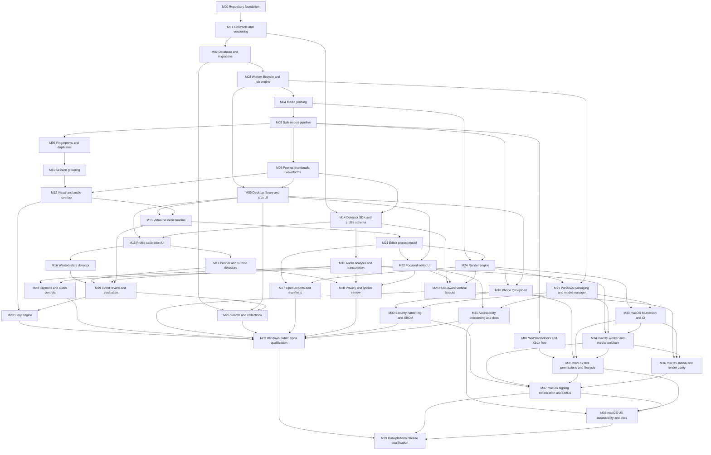

# OpenWorld Moments Milestones

This document is the execution index for the repository. Every implementation task is called a **milestone** and is designed to fit one focused agent or contributor session. The roadmap contains 40 milestones, M00 through M39. Each milestone should normally produce one branch, one pull request, and one mergeable increment.

The detailed product requirements remain in [OPENWORLD_MOMENTS_BUILD_SPEC.md](./OPENWORLD_MOMENTS_BUILD_SPEC.md). Individual briefs live in [docs/milestones](./docs/milestones/).

## Milestone contract

An agent assigned a milestone must:

1. Read the repository README, product specification, this index, and the assigned brief.
2. Confirm every dependency is already merged.
3. Work only within the milestone's scope.
4. Preserve existing user and contributor changes.
5. Add or update the tests required by the brief.
6. Run all milestone validation commands plus repository-wide checks affected by the change.
7. Update documentation and contracts when behavior changes.
8. Update the README's **Project status** table and **Current next step** section.
9. Finish with a handoff summary using the template in [CONTRIBUTING.md](./CONTRIBUTING.md).

A milestone is not complete when the code merely compiles. It is complete when every acceptance criterion is demonstrably satisfied.

## Branch and pull-request convention

```text
Branch: milestone/MXX-short-name
PR:     [MXX] Imperative description
Commit: MXX: concise change description
```

Do not combine milestones in a single branch. If a blocking prerequisite defect is discovered, either stop and report it or make the smallest prerequisite repair and call it out explicitly in the handoff.

## Definition of a one-session milestone

A milestone should have:

- One primary technical objective.
- A bounded set of owned modules.
- No unresolved product decisions.
- Fewer than roughly ten meaningful implementation steps.
- Deterministic acceptance criteria.
- Tests runnable without private gameplay footage.
- A clean stopping point that leaves the main branch usable.

If the assigned work cannot meet those constraints, the agent should propose a split before implementing a partial architecture that another milestone must undo.

## Milestone dependency graph



## Parallel work lanes

Once their dependencies are merged, the following milestones are intentionally parallel-safe:

- M06, M07, and M08 after M05.
- M10, M11, and continued library UI work after M09/M06.
- M16, M17, and M18 after M14/M15 as specified.
- M20, M21, M24, and M26 after their separate prerequisites.
- M23, M25, M27, and M28 once the editor model/UI is stable.
- M33 can begin after M24/M29 while independent product milestones continue.
- M35 and M36 may proceed in parallel after M34, but must coordinate bundle and capability contracts.

Parallel agents must not edit the same generated contract or migration without coordinating first.

## Copy/paste assignment prompt

Replace both occurrences of `MXX` before starting a session:

```text
Implement milestone MXX using docs/milestones/MXX-name.md.

Read AGENTS.md, README.md, OPENWORLD_MOMENTS_BUILD_SPEC.md, MILESTONES.md,
the complete MXX brief, and the merged handoffs of every dependency. Work only
within MXX scope. Satisfy every acceptance criterion, run and report all required
validation, update affected documentation, and finish with the repository's
milestone handoff. Do not start a dependent milestone or claim completion if any
required check is skipped.
```

## Milestone index

| ID | Milestone | Depends on | Primary output | Brief |
|---|---|---|---|---|
| M00 | Repository foundation | None | Buildable monorepo, CI, licenses, standards | [Open](./docs/milestones/M00-repository-foundation.md) |
| M01 | Contracts and versioning | M00 | Versioned JSON Schemas and generated types | [Open](./docs/milestones/M01-contracts-and-versioning.md) |
| M02 | Database and migrations | M01 | SQLite schema, migrations, repositories | [Open](./docs/milestones/M02-database-and-migrations.md) |
| M03 | Worker lifecycle and job engine | M02 | Authenticated worker IPC and durable jobs | [Open](./docs/milestones/M03-worker-lifecycle-and-jobs.md) |
| M04 | Media probing | M03 | FFprobe capability and normalized media metadata | [Open](./docs/milestones/M04-media-probing.md) |
| M05 | Safe import pipeline | M04 | Reference/managed imports and staging | [Open](./docs/milestones/M05-safe-import-pipeline.md) |
| M06 | Fingerprints and duplicate detection | M05 | Exact/fast/perceptual identity pipeline | [Open](./docs/milestones/M06-fingerprints-and-duplicates.md) |
| M07 | Watched folders and Xbox onboarding | M05 | Stable folder watcher and OneDrive flow | [Open](./docs/milestones/M07-watched-folders-and-xbox.md) |
| M08 | Proxies, thumbnails, and waveforms | M04, M05 | Derived-media pipeline with HDR handling | [Open](./docs/milestones/M08-derived-media.md) |
| M09 | Desktop library and jobs UI | M03, M05, M08 | First usable import/library experience | [Open](./docs/milestones/M09-library-and-jobs-ui.md) |
| M10 | Phone QR upload | M05, M09 | Temporary isolated LAN transfer | [Open](./docs/milestones/M10-phone-qr-upload.md) |
| M11 | Session grouping | M06 | Explainable metadata-based grouping | [Open](./docs/milestones/M11-session-grouping.md) |
| M12 | Visual and audio overlap | M08, M11 | Duplicate-time alignment and confidence | [Open](./docs/milestones/M12-overlap-alignment.md) |
| M13 | Virtual session timeline | M09, M12 | Unique-time playback across source files | [Open](./docs/milestones/M13-virtual-session-timeline.md) |
| M14 | Detector SDK and profile schema | M01, M03, M08 | Extensible detector/profile runtime | [Open](./docs/milestones/M14-detector-sdk-and-profiles.md) |
| M15 | Profile calibration UI | M09, M14 | ROI calibration and profile patches | [Open](./docs/milestones/M15-profile-calibration.md) |
| M16 | Wanted-state detector | M15 | First temporal GTA-aware detector | [Open](./docs/milestones/M16-wanted-state-detector.md) |
| M17 | Banner and subtitle detectors | M15 | OCR-based state/dialogue events | [Open](./docs/milestones/M17-banner-and-subtitle-detectors.md) |
| M18 | Audio analysis and transcription | M14 | Audio evidence and optional local words | [Open](./docs/milestones/M18-audio-and-transcription.md) |
| M19 | Event review and evaluation | M13, M16, M17, M18 | Evidence UI and reproducible metrics | [Open](./docs/milestones/M19-event-review-and-evaluation.md) |
| M20 | Story engine | M12, M19 | Explainable setup-to-payoff suggestions | [Open](./docs/milestones/M20-story-engine.md) |
| M21 | Editor project model | M01, M02, M13 | Non-destructive EDL, autosave, undo model | [Open](./docs/milestones/M21-editor-project-model.md) |
| M22 | Focused editor UI | M09, M21 | Trim/split/reorder playback interface | [Open](./docs/milestones/M22-focused-editor-ui.md) |
| M23 | Captions and audio controls | M18, M22 | Caption correction, mute, and gain | [Open](./docs/milestones/M23-captions-and-audio.md) |
| M24 | Render engine | M04, M21 | Validated FFmpeg rendering and presets | [Open](./docs/milestones/M24-render-engine.md) |
| M25 | HUD-aware vertical layouts | M14, M22, M24 | Safe crop, fit, and layout keyframes | [Open](./docs/milestones/M25-hud-aware-vertical-layouts.md) |
| M26 | Search and collections | M02, M09, M19 | FTS search, filters, and collections | [Open](./docs/milestones/M26-search-and-collections.md) |
| M27 | Open exports and manifests | M21, M24 | JSONL, captions, OTIO, and reproducibility | [Open](./docs/milestones/M27-open-exports-and-manifests.md) |
| M28 | Privacy and spoiler review | M17, M18, M22 | Review gates, blur regions, risk flags | [Open](./docs/milestones/M28-privacy-and-spoiler-review.md) |
| M29 | Windows packaging and model manager | M03, M08, M24 | Installable signed-ready alpha package | [Open](./docs/milestones/M29-windows-packaging-and-models.md) |
| M30 | Security hardening and SBOM | M10, M29 | Threat-model closure, dependency inventory | [Open](./docs/milestones/M30-security-hardening-and-sbom.md) |
| M31 | Accessibility, onboarding, and documentation | M22, M29 | Keyboard-complete onboarding and user docs | [Open](./docs/milestones/M31-accessibility-onboarding-docs.md) |
| M32 | Windows public alpha qualification | M20, M23, M25–M31 | Windows release candidate and qualification report | [Open](./docs/milestones/M32-public-alpha-qualification.md) |
| M33 | macOS foundation and CI | M24, M29 | Native host builds, platform contract, dual-architecture CI | [Open](./docs/milestones/M33-macos-foundation-and-ci.md) |
| M34 | macOS worker and media toolchain | M18, M29, M33 | Native worker/FFmpeg bundles and model compatibility | [Open](./docs/milestones/M34-macos-worker-and-media-toolchain.md) |
| M35 | macOS files, permissions, and lifecycle | M07, M10, M33, M34 | Safe imports, watchers, storage, sleep/wake, and phone LAN flow | [Open](./docs/milestones/M35-macos-files-permissions-and-lifecycle.md) |
| M36 | macOS media and render parity | M25, M33, M34 | Playback, proxy, VideoToolbox, color, and render parity | [Open](./docs/milestones/M36-macos-media-and-render-parity.md) |
| M37 | macOS signing, notarization, and DMGs | M30, M34–M36 | Signed and notarized native DMGs | [Open](./docs/milestones/M37-macos-signing-notarization-and-dmg.md) |
| M38 | macOS UX, accessibility, and documentation | M31, M35, M37 | Native conventions, VoiceOver, onboarding, and guides | [Open](./docs/milestones/M38-macos-ux-accessibility-and-docs.md) |
| M39 | Dual-platform release qualification | M32, M37, M38 | Qualified Windows and macOS release assets | [Open](./docs/milestones/M39-dual-platform-release-qualification.md) |

## Required quality gates by lane

### Foundation and backend milestones

- Formatting and linting.
- Static type checks.
- Unit tests.
- Migration tests when storage changes.
- Contract compatibility tests when schemas change.

### Media milestones

- Synthetic fixture tests.
- FFprobe validation.
- Cancellation and failure-path tests.
- No source mutation.
- Paths with spaces, Unicode, and long names.

### Detector milestones

- Versioned fixture manifest.
- Precision/recall or explicit synthetic-case table.
- False-positive cases.
- Performance measurement.
- Evidence and confidence validation.

### UI milestones

- Keyboard path.
- Empty, loading, success, error, and cancelled states.
- Component tests.
- At least one end-to-end happy path.
- Screenshot or screen recording in the handoff when visual behavior changes.

### Release milestones

- Clean-machine validation on every claimed OS and CPU architecture.
- Dependency and license inventory.
- Upgrade/rollback behavior.
- Security review.
- Documented known limitations.
- Signature, notarization, Gatekeeper, checksum, and architecture verification where applicable.

## Milestone completion ledger

Each milestone pull request updates its own row **in the same pull request**, so the ledger changes exactly when the milestone merges. No separate ledger PRs.

- Set **Status** to `Complete`, link the **PR**, and fill **Completed by** and **Notes**.
- Leave **Commit** as `—`; the PR link records the merge commit.
- Change any milestone whose dependencies are now all complete to `Ready`.

| Milestone | Status | PR | Commit | Completed by | Notes |
|---|---|---|---|---|---|
| M00 | Complete | [#1](https://github.com/heetdalsania/openworld-moments/pull/1) | — | Arun Velkumar | Licenses pending maintainer confirmation; CI green on Linux + Windows |
| M01 | Complete | [#5](https://github.com/heetdalsania/openworld-moments/pull/5) | — | Arun Velkumar | JSON Schema 2020-12 contracts at schema_version 1.0; TS + Pydantic generated; CI drift check |
| M02 | Complete | [#6](https://github.com/heetdalsania/openworld-moments/pull/6) | — | Arun Velkumar | SQLite (WAL) schema v1 for all §9.7 tables; in-house migration runner with backups; typed repositories |
| M03 | Complete | [#7](https://github.com/heetdalsania/openworld-moments/pull/7) | — | Arun Velkumar | Rust supervisor + loopback token-auth FastAPI worker; durable jobs with WebSocket progress; contracts 1.1, migration 0002 |
| M04 | Complete | [#8](https://github.com/heetdalsania/openworld-moments/pull/8) | — | Arun Velkumar | FFprobe probe job (exact rationals, clockwise rotation, HDR side data, stable error codes), `doctor` + `/v1/capabilities`, synthetic fixtures; FFmpeg ≥ 6.0; contracts 1.2, migration 0003 |
| M05 | Complete | [#9](https://github.com/heetdalsania/openworld-moments/pull/9) | — | Arun Velkumar | Reference + managed imports (staging, atomic content-addressed promotion), idempotency keys, provenance, missing-source check, SHA-256-verified relink; contracts 1.3, migration 0004 |
| M06 | Complete | [#10](https://github.com/heetdalsania/openworld-moments/pull/10) | — | Arun Velkumar | Fast partial hash (no re-copy of known files, relink pre-check), versioned dhash256 head/tail frame and energy-envelope audio fingerprints, review-only duplicate candidates, restartable backfill; contracts 1.4, migration 0005 |
| M07 | Complete | [#12](https://github.com/heetdalsania/openworld-moments/pull/12) | — | Arun Velkumar | Rust watcher (notify + 15-min reconciliation, 10 s stabilization, offline backoff, cloud placeholders), worker-side folder settings and per-version file records with deduplicated imports, settings UI and Xbox/OneDrive onboarding; contracts 1.5, migration 0006 |
| M08 | Complete | [#13](https://github.com/heetdalsania/openworld-moments/pull/13) | — | Arun Velkumar | Explainable proxy policy; deterministic H.264 SDR proxies with LUT-based (lut3d, no zimg) HDR tone mapping; filmstrip JPEGs and owm-waveform peaks; versioned recipes and cache keys, atomic key-named promotion, FFprobe and sampled-decode validation, cancellable FFmpeg with progress, link-safe cleanup; contracts 1.6, migration 0007 |
| M09 | Complete | [#14](https://github.com/heetdalsania/openworld-moments/pull/14) | — | Arun Velkumar | App shell with Library and Settings; import by button or drag and drop; newest-first keyset-paged library; clip view playing proxy or original over an allow-listed `owm-media` Range protocol; automatic playback preparation; durable job center with live events, cancel, retry, readable errors; keyboard-complete; `worker_api` route allowlist; E2E import-to-playback test |
| M10 | Ready | — | — | — | — |
| M11 | Ready | — | — | — | — |
| M12–M13 | See dependency graph | — | — | — | — |
| M14 | Ready | — | — | — | — |
| M15–M39 | See dependency graph | — | — | — | — |

## Scope-change procedure

If implementation reveals that a milestone is too large or invalid:

1. Stop before introducing a partial architecture.
2. Document the discovered constraint.
3. Propose new milestone boundaries and dependency changes.
4. Update the product specification only if product behavior changes.
5. Merge the planning change before restarting implementation.

This prevents separate agents from building against different assumptions.

