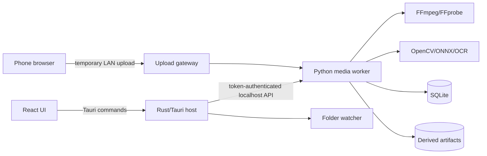

# OpenWorld Moments

## Product and Engineering Build Specification

> Status: Draft v1.0  
> Date: November 4, 2026  
> Working repository name: `openworld-moments`  
> Initial compatibility target: Grand Theft Auto VI console captures  
> Product category: Local-first console capture organizer, gameplay understanding engine, and content creation tool  
> Affiliation: Unofficial community project; not affiliated with Rockstar Games, Take-Two Interactive, Sony, or Microsoft

---

## 1. Executive summary

OpenWorld Moments is an open-source desktop application that turns fragmented console gameplay captures into searchable sessions and editable, publish-ready stories.

The product does **not** run on a console, record the console directly, inject into a game, read game memory, or require a Rockstar account. It operates on video files that the player already owns:

- Xbox captures synchronized through OneDrive.
- PlayStation 5 captures downloaded through PlayStation App and uploaded over the local network.
- Files copied by USB, AirDrop, cloud drive, or manual import.
- OBS and capture-card recordings.
- Stream VOD files supplied by the user.

The central product insight is that console captures are frequently short, fragmented, poorly named, and disconnected from the larger moment. A robbery, chase, crash, and reaction may be spread across several recordings. Generic clippers treat each file independently and generic video editors require manual scrubbing. OpenWorld Moments reconstructs the session, recognizes visible gameplay events, proposes a coherent beginning-middle-end cut, and keeps every decision editable.

The initial release should solve this workflow:

```text
Console captures
    -> automatic or manual import
    -> deduplication and session reconstruction
    -> GTA-aware event detection
    -> searchable timeline
    -> story suggestions with setup and payoff
    -> HUD-aware horizontal or vertical render
    -> ordinary files and editable timeline exports
```

The project should be designed around a reusable read-only event engine. In later releases, the same engine can support live OBS markers, challenge overlays, accessibility narration, speedrun splitting, and gameplay statistics. Those features are extensions, not MVP requirements.

### 1.1 Product thesis

The project wins by being:

1. **Console-first.** It works with the captures console players can obtain today.
2. **Session-aware.** It understands that several files may represent one continuous event.
3. **Game-aware.** It detects gameplay state rather than relying only on loudness or transcript excitement.
4. **Story-aware.** It preserves setup, escalation, payoff, and reaction.
5. **Local-first.** Source footage stays on the user's computer unless the user explicitly exports or uploads it.
6. **Open and interoperable.** It exports normal media, captions, metadata, and editor timelines.
7. **Evidence-based.** Every suggestion explains which visible or audible signals caused it.

### 1.2 MVP in one sentence

Import a folder of console captures, automatically group overlapping files into sessions, find notable GTA-style events, and turn selected events into editable 16:9 or 9:16 clips without uploading the footage to a service.

---

## 2. Problem definition

### 2.1 User problem

Console players can save gameplay, but the resulting media workflow is weak:

- Captures are stored as generic filenames.
- Several captures may overlap or repeat footage.
- A meaningful sequence may be split across multiple files.
- The player has to remember which file contains which event.
- Moving PS5 captures from console to an editor requires several steps.
- Generic AI clippers miss quiet visual events and often clip the reaction without its cause.
- Center-cropped vertical video removes the minimap, subtitles, wanted level, or relevant action.
- Editing applications are powerful but demand time and prior editing knowledge.
- Cloud clippers introduce upload delays, privacy questions, usage limits, and recurring cost.

### 2.2 Market gap

Existing tools solve adjacent parts of the workflow:

- Replay recorders solve background capture on PC.
- PlayStation and Xbox solve basic capture creation and sharing.
- Generic AI clippers detect loudness, speech, faces, and broad visual activity.
- Video editors solve manual composition.
- Semantic search products index generic video libraries.

The missing layer is a local, console-aware application that reconstructs fragmented captures and understands open-world gameplay events well enough to propose a complete story.

### 2.3 Why not build a console application

A normal third-party console application would not be expected to receive privileged access to another running game's memory or rendered framebuffer. Console publication also requires platform approval and certification. The realistic independent path is to process captures outside the console.

### 2.4 Why not build a recorder

The launch platforms already record gameplay, and PC recording is a crowded category. Rebuilding an encoder, replay buffer, audio mixer, and overlay stack would consume most of the development effort without creating meaningful differentiation.

### 2.5 Why not build another map or checklist

GTA VI maps, databases, vehicle catalogs, completion checklists, spoiler blockers, and static creator overlays are already crowded. A new entrant would depend on duplicating community data and competing on content volume or search ranking. OpenWorld Moments instead creates novel value from a player's own media.

---

## 3. Goals and non-goals

### 3.1 Product goals

- Make console capture ingestion understandable and reliable.
- Reduce time from imported footage to a usable draft clip.
- Reconstruct sessions from overlapping or adjacent capture files.
- Detect a small number of GTA-relevant events accurately before expanding coverage.
- Keep all suggested boundaries, labels, and layouts editable.
- Preserve gameplay context and important HUD regions in vertical exports.
- Provide a searchable, durable local library.
- Operate without an account, subscription, or mandatory cloud AI provider.
- Publish a stable event and project schema that other open-source tools can consume.
- Make detector quality measurable with replayable evaluation fixtures.

### 3.2 MVP non-goals

- Running code on PlayStation or Xbox.
- Automatically recording gameplay on the console.
- Reading game memory, network traffic, save files, or proprietary APIs.
- Modifying GTA VI or interacting with GTA Online.
- Fully automatic publishing to TikTok, Instagram, YouTube, or X.
- Promising that a clip will become viral.
- Generating synthetic gameplay or replacing missing gameplay with AI video.
- Providing a full nonlinear editor comparable to DaVinci Resolve or Premiere Pro.
- Supporting every game, every language, and every HUD configuration in v1.
- Training large foundation models from scratch.
- Hosting or redistributing copyrighted gameplay footage.

### 3.3 Safety boundaries

- The application is read-only with respect to the game and console.
- It never generates controller input or game automation.
- It never scans unrelated folders without explicit user selection.
- It does not upload source footage by default.
- It does not support leaked or pre-release footage as project fixtures.
- It does not include official artwork, logos, audio, video, map tiles, or extracted game assets.
- It does not market itself as official or endorsed.

---

## 4. Target users

### 4.1 Primary persona: console creator

**Profile:** Plays on PS5 or Xbox Series X|S and regularly saves short clips for YouTube Shorts, TikTok, Instagram Reels, Discord, or friends.

**Needs:**

- Easy import.
- Fast review.
- Automatic grouping and trimming.
- Vertical exports that retain useful context.
- No complex editor setup.

### 4.2 Secondary persona: streamer/editor

**Profile:** Records through OBS or a capture card, or edits footage for another creator.

**Needs:**

- Batch processing.
- Search across many hours of footage.
- Evidence-backed markers.
- Editable timeline export.
- Repeatable creator presets.

### 4.3 Secondary persona: archivist/player

**Profile:** Wants a private, organized history of memorable sessions without becoming a content creator.

**Needs:**

- Local library.
- Search and filters.
- Duplicate removal.
- Session summaries.
- Reliable original-file preservation.

### 4.4 Future persona: integration developer

**Profile:** Wants structured gameplay events for an OBS overlay, challenge tool, accessibility helper, or research prototype.

**Needs:**

- Stable JSON schema.
- Versioned detector profiles.
- CLI and local API.
- Test fixtures and confidence metadata.

---

## 5. Product principles

### 5.1 Suggest, do not conceal

Automation must produce a draft and show why it made each decision. The user should never have to reverse engineer an unexplained “AI score.”

### 5.2 Preserve originals

Imported source files are read-only. Trimming, merging, muting, captions, crops, and layout changes are represented as project data until export.

### 5.3 Deterministic before generative

Use metadata, hashes, template matching, OCR, temporal rules, audio measurements, and small classifiers before invoking a general multimodal model. Optional models may add labels or ranking, but they must not fabricate events.

### 5.4 Local by default

The core application must work without an account or API key. Optional cloud services, if added later, must be explicit, scoped, and disabled by default.

### 5.5 Degrade gracefully

If transcription is unavailable, visual detection still works. If a game profile is missing, import, playback, manual tagging, trimming, and export still work.

### 5.6 Interoperate instead of replacing

The application should complement professional editors. It must export ordinary files and open timeline formats rather than trapping work in a proprietary project.

### 5.7 Accuracy is a feature

The product should say “unknown” rather than create a confident but unsupported label. Confidence, evidence, detector version, and review state are first-class data.

---

## 6. Core user journeys

### 6.1 Xbox OneDrive journey

1. User enables Xbox capture backup to OneDrive.
2. User installs OneDrive sync on the desktop.
3. During onboarding, OpenWorld Moments asks the user to select the synchronized Xbox captures folder.
4. A file watcher detects new, stable video files.
5. The application probes the file, computes fingerprints, and imports metadata without moving the original.
6. The file is grouped into an existing session or starts a new one.
7. Lightweight detectors run automatically.
8. The Inbox shows a new session and suggested moments.

### 6.2 PS5 phone-to-desktop journey

1. User enables PS5 capture uploads to PlayStation App.
2. User downloads one or more clips to the phone.
3. OpenWorld Moments displays a temporary QR code.
4. User scans the code while the phone and desktop are on the same network.
5. A mobile upload page opens and accepts selected video files.
6. Files transfer directly over the local network.
7. The desktop confirms integrity and closes the temporary upload endpoint.
8. The files enter the same import and analysis pipeline as local files.

Future native mobile applications may add a share-sheet target, but the QR upload workflow avoids requiring mobile app-store distribution for the MVP.

### 6.3 Manual import journey

1. User drags files or a folder into the application.
2. Application shows estimated disk impact and whether files will be referenced or copied.
3. User chooses “Reference in place” or “Copy into library.”
4. Import begins and progress remains visible.
5. Duplicate files are skipped without deleting anything.

### 6.4 Session-to-story journey

1. User opens a reconstructed session.
2. Timeline displays source-file boundaries, overlaps, transcript, audio waveform, and detected events.
3. Suggested stories appear as cards such as “Three-star chase ends in a rollover.”
4. Selecting a story previews the proposed setup, incident, escalation, payoff, and reaction.
5. User adjusts boundaries, layout, captions, or title.
6. User renders one or several aspect ratios.
7. Exports are stored beside a portable project manifest.

### 6.5 Search journey

1. User searches `motorcycle crash at night`.
2. Search combines structured tags, transcript text, OCR text, date/time, and optional visual embeddings.
3. Results open at the relevant timestamp rather than merely opening the file.
4. User adds results to a collection or creates a compilation.

---

## 7. Scope and release tiers

### 7.1 P0: required for public alpha

- Windows 11 desktop package.
- Manual file and folder import.
- Xbox OneDrive watched-folder import.
- Local-network mobile upload page.
- MP4, MOV, and MKV probing through FFprobe.
- H.264 and HEVC playback through generated proxies when necessary.
- Content-addressed duplicate detection.
- Basic session grouping by timestamps and file adjacency.
- Visual overlap detection for adjacent clips.
- Timeline playback and manual tagging.
- Detector framework and versioned game profiles.
- Initial detectors:
  - Wanted-level change.
  - Death/failure banner.
  - Arrest/busted banner.
  - Mission completion/failure banner.
  - Subtitle/dialogue region OCR.
  - Audio excitement and impact peaks.
- Story-window generation with editable start/end points.
- Horizontal and safe vertical export.
- SRT/VTT caption export.
- JSON project and event export.
- No account, no telemetry, no mandatory cloud services.

### 7.2 P1: required for cross-platform beta

- Notarized macOS package for Apple Silicon.
- Notarized macOS package for supported Intel Macs.
- Better session reconstruction using audio correlation.
- Full-text library search.
- Optional local transcription.
- Dynamic HUD-aware vertical layouts.
- Facecam detection and stacked facecam/game layouts.
- Username/gamertag blur regions.
- Spoiler review flags.
- OpenTimelineIO and Final Cut Pro XML export.
- Creator style presets.
- Model manager and optional GPU acceleration.
- Detector evaluation dashboard.

### 7.3 P2: post-beta

- Linux package.
- Natural-language visual search.
- DaVinci Resolve and Premiere-specific round trips.
- Story compilation across sessions.
- Vehicle and stunt classifiers.
- Location recognition.
- Local collaboration/project bundles.
- OBS marker integration.
- Capture-card live event mode.
- Creator challenge overlays.
- Accessibility text-to-speech adapter.
- Speedrun/LiveSplit adapter.

### 7.4 Explicitly deferred

- Direct social publishing.
- Cloud project synchronization.
- Team workspaces.
- Monetization or hosted inference.
- Game input automation.
- Console-store applications.

---

## 8. Functional requirements

### 8.1 Ingestion

#### 8.1.1 Supported inputs

- Individual files.
- Recursive folder import.
- Watched folders.
- Local-network upload.
- Optional URL/VOD ingestion after the MVP, subject to platform terms and user authorization.

#### 8.1.2 File stabilization

A watched file must not be imported while OneDrive, a browser, or another application is still writing it.

The watcher should consider a file stable when:

- Size and modification time remain unchanged for a configurable period, default 10 seconds.
- The file can be opened for reading.
- FFprobe can read stream metadata.
- The container duration is nonzero and internally consistent.

#### 8.1.3 Import modes

**Reference in place:** The database points to the original. Lowest disk usage; moving the original may break the link.

**Managed copy:** The application copies the file into its media library. Safer for phone uploads and removable drives.

**Move:** Not offered in the MVP because it is destructive and complicates recovery.

#### 8.1.4 Integrity and identity

Each asset receives:

- SHA-256 for exact identity.
- Fast partial hash for early duplicate screening.
- Container and stream metadata.
- Perceptual frame fingerprints.
- Optional audio fingerprint.
- Import source and original path.
- Capture time estimate and provenance.

Exact duplicates must not be imported twice. Perceptual duplicates should be reported but never automatically deleted.

### 8.2 Session reconstruction

#### 8.2.1 Grouping signals

The grouping engine should combine:

- File creation and modification timestamps.
- Filename timestamp patterns.
- Import order.
- Source device or watched-folder identity.
- Resolution, frame rate, codec, and audio format.
- Visual similarity near adjacent file boundaries.
- Audio correlation near adjacent file boundaries.
- Repeated frame sequences caused by replay-buffer overlap.

#### 8.2.2 Grouping rules

Initial heuristic:

- Same source profile.
- Capture-time gap below 15 minutes.
- Similar encoding properties.
- No contradictory game/profile evidence.
- Increase confidence when visual or audio overlap is found.

The user must be able to merge sessions, split sessions, reorder files, and mark files as unrelated.

#### 8.2.3 Overlap detection

Console replay captures often repeat the same footage. To find overlap between file A and file B:

1. Sample the final 30 seconds of A and first 30 seconds of B.
2. Generate perceptual hashes or image embeddings at one to two frames per second.
3. Find candidate alignments using nearest neighbors.
4. Verify a candidate with sequential frame consistency.
5. Refine the boundary through audio cross-correlation when audio exists.
6. Store the overlap offset and confidence.

The virtual session timeline should hide repeated time by default while preserving both source files.

#### 8.2.4 Capture time confidence

Capture time is not always preserved after mobile download. Store both the estimated value and its source:

```json
{
  "captured_at": "2026-11-20T03:14:22-07:00",
  "confidence": 0.62,
  "basis": ["filename", "import_order", "filesystem_mtime"]
}
```

### 8.3 Media preparation

#### 8.3.1 Source preservation

Analysis must not rewrite the source container. Media preparation produces derived assets:

- Playback proxy.
- Thumbnails and filmstrip images.
- Waveform data.
- Analysis frames.
- Audio analysis track.
- Transcript and word timings.

#### 8.3.2 Proxy strategy

Generate a proxy when the source cannot be decoded smoothly by the embedded player or when it is HDR/HEVC and the platform lacks reliable playback.

Recommended proxy:

- H.264, 8-bit, yuv420p.
- 1280-pixel maximum width.
- Same frame rate where practical.
- AAC stereo.
- Fast-start MP4.
- SDR tone mapping for HDR sources.

Proxy generation should be cancellable and resumable.

#### 8.3.3 HDR handling

- Preserve the original HDR file.
- Detect transfer characteristics and color primaries through FFprobe.
- Use a deterministic tone-mapping filter for proxies and SDR social exports.
- Offer an advanced HDR-preserving export only after color validation on supported platforms.

### 8.4 Event detection

#### 8.4.1 Event design

Events are factual observations with a time range, confidence, detector identity, and evidence. They are not predicted view counts or creative judgments.

Example:

```json
{
  "schema_version": "1.0",
  "id": "evt_01J...",
  "session_id": "ses_01J...",
  "type": "openworld.wanted_level_changed",
  "start_ms": 823400,
  "end_ms": 824100,
  "confidence": 0.97,
  "attributes": {
    "from": 2,
    "to": 4
  },
  "evidence": [
    {
      "kind": "hud_template",
      "region": [0.78, 0.02, 0.20, 0.12],
      "score": 0.98
    },
    {
      "kind": "temporal_consistency",
      "frames": 18,
      "score": 0.96
    }
  ],
  "detector": {
    "id": "wanted-stars",
    "version": "0.3.0",
    "profile": "open-world-vi/1080p/default"
  },
  "review_state": "unreviewed"
}
```

#### 8.4.2 Detector types

- Normalized-region template matching.
- Color and shape rules.
- OCR with vocabulary constraints.
- Temporal state machines.
- Audio energy and spectral event detection.
- Speech transcription and phrase matching.
- Lightweight ONNX object classifiers.
- Optional multimodal model corroboration.

#### 8.4.3 Temporal consistency

Single-frame recognition is not enough. A detector should define:

- Minimum confirmation frames.
- Maximum tolerated missing frames.
- Valid state transitions.
- Cooldown/debounce period.
- Confidence aggregation.

For example, wanted-level state should not flicker between two and three stars because of compression artifacts. A new value should be observed consistently before an event is emitted.

#### 8.4.4 Initial detector set

##### Wanted level

- Detect zero through maximum visible stars or equivalent wanted indicators.
- Emit only on stable state change.
- Record escalation and de-escalation separately.
- Support profile-specific HUD positions.

##### Death/failure

- Detect prominent failure banner through OCR and visual style.
- Distinguish story death, mission failure, and general failure when evidence permits.
- Avoid hard-coding English text only; vocabulary belongs in locale packs.

##### Arrest/busted

- Same architecture as death/failure with a separate event type.

##### Mission state

- Detect mission start, objective updates, completion, and failure banners.
- Store OCR text only when confidence clears a threshold.
- Mark potentially story-sensitive text with a spoiler risk.

##### Dialogue/subtitles

- Detect subtitle regions.
- OCR or transcribe audio.
- Associate speaker labels when visibly present.
- Preserve exact timestamps for caption export.

##### Audio peaks

- Measure loudness, onset strength, impacts, laughter-like bursts, and speech rate.
- Treat audio as supporting evidence, not proof that an event was important.

#### 8.4.5 Detector profiles

Profiles isolate game-, resolution-, HUD-, and locale-specific knowledge.

Example:

```yaml
schema_version: 1
id: open-world-vi-1080p-en
display_name: Open-world VI, 1080p, English
game_family: open-world-vi
frame:
  aspect_ratios: ["16:9"]
  min_width: 1280
  min_height: 720
regions:
  wanted_indicator: [0.78, 0.00, 0.22, 0.14]
  subtitle: [0.15, 0.72, 0.70, 0.22]
  mission_banner: [0.15, 0.20, 0.70, 0.35]
detectors:
  - id: wanted-stars
    enabled: true
    min_confidence: 0.88
    confirmation_frames: 8
  - id: failure-banner
    enabled: true
    locale: en
safe_zones:
  preserve:
    - wanted_indicator
    - subtitle
    - minimap
```

Coordinates are normalized so profiles survive resolution changes. The calibration UI should let users adjust regions and export a profile patch.

#### 8.4.6 Optional multimodal analysis

A local or user-selected multimodal model may propose broader labels such as `vehicle crash`, `stunt`, or `NPC chaos`. These labels must:

- Reference specific sampled frames.
- Carry the model identifier and prompt version.
- Remain suggestions until reviewed.
- Never overwrite deterministic detector output.
- Be fully disabled when the user chooses deterministic-only mode.

### 8.5 Narrative/story engine

#### 8.5.1 Purpose

The story engine converts low-level events into candidate edit windows. It should optimize for understandable context, not generic engagement scoring.

#### 8.5.2 Narrative beats

Candidate stories may contain:

- **Setup:** The decision or situation needed to understand the incident.
- **Incident:** The first meaningful event.
- **Escalation:** Increased danger, difficulty, or absurdity.
- **Payoff:** Escape, success, failure, crash, discovery, or joke resolution.
- **Reaction:** Player, party, facecam, or dialogue response.

Not every story needs every beat, but the interface should show which beats were found.

#### 8.5.3 Window construction

1. Convert high-confidence events into seed windows.
2. Add configurable pre-roll and post-roll.
3. Merge overlapping or causally related windows.
4. Expand to complete transcript sentences.
5. Prefer scene or silence boundaries where they do not remove context.
6. Remove replay-buffer duplicate time.
7. Enforce preset duration ranges.
8. Generate one or more boundary alternatives.

#### 8.5.4 Story presets

| Preset | Target duration | Intended use |
|---|---:|---|
| Moment | 10–25 s | Discord, quick share |
| Short | 25–60 s | Shorts, Reels, TikTok |
| Extended Short | 60–180 s | YouTube Shorts or longer vertical story |
| Highlight | 30–120 s | Horizontal social/video insert |
| Compilation | User defined | Multiple moments across sessions |

#### 8.5.5 Story score

The internal score should be inspectable and composed from explicit terms:

```text
story_score =
    event_confidence
  + setup_coverage
  + payoff_coverage
  + reaction_evidence
  + continuity_score
  - duplicate_penalty
  - dead_air_penalty
  - truncation_penalty
  - spoiler_risk_penalty_when_enabled
```

Do not label this a “viral score.” It measures edit completeness and detector evidence, not future performance.

### 8.6 Search and library

#### 8.6.1 Searchable fields

- Session and story titles.
- User notes and tags.
- Event types and attributes.
- Transcript and OCR text.
- Capture date and import date.
- Source platform and source folder.
- Duration, resolution, and aspect ratio.
- Review state.
- Optional visual embeddings in P2.

#### 8.6.2 Collections

Users can create non-destructive collections such as:

- Best crashes.
- Five-star escapes.
- Funny dialogue.
- Vehicle tests.
- Clips to publish.
- Published archive.

#### 8.6.3 Original-file status

The library must clearly show:

- Original available.
- Referenced file moved or missing.
- Proxy available.
- Analysis incomplete.
- Duplicate candidate.
- Exported versions.

### 8.7 Editing experience

#### 8.7.1 Editor scope

The MVP editor is a focused clip editor, not a general NLE. It supports:

- In/out trimming.
- Multiple source segments on one primary track.
- Reordering.
- Split and remove.
- Audio mute and simple gain.
- Caption correction.
- Crop/layout selection.
- Text title and watermark overlay.
- Preview of aspect-ratio variants.

#### 8.7.2 Timeline behavior

- Source boundaries and hidden overlaps are visible.
- Detected events appear as markers.
- Hovering an event explains evidence.
- Transcript words remain synchronized after trimming.
- Undo/redo is required.
- Edits autosave as project data.

#### 8.7.3 HUD-aware vertical layouts

Initial strategies:

1. **Fit with background:** Entire 16:9 gameplay remains visible over a blurred or solid background.
2. **Safe crop:** Crop horizontally while protecting profile-defined HUD and subtitle regions.
3. **Dynamic focus:** Move the crop between action regions with damped transitions.
4. **Stacked facecam:** Gameplay and facecam use separate vertical regions.
5. **Manual keyframes:** User marks focus points when automation fails.

The default should favor legibility and context over filling every pixel.

#### 8.7.4 Caption behavior

- Word- or segment-timed captions.
- Editable text before render.
- SRT and VTT sidecar export.
- Optional burn-in.
- Presets that avoid the game's subtitle and HUD regions.
- Profanity masking is opt-in.
- Translation and dubbing are deferred.

### 8.8 Privacy and creator-safety review

#### 8.8.1 Privacy checks

- Detect likely usernames in configured HUD/chat regions.
- Let the user add blur regions that track through the clip.
- Offer voice-chat track muting when separate audio tracks exist.
- Warn that mixed console audio cannot be perfectly separated.

#### 8.8.2 Spoiler review

Flag, but do not automatically censor:

- Mission titles and objective text.
- Cutscene-like segments.
- Long dialogue-heavy sequences.
- Ending or finale vocabulary from user-maintained blocklists.

Spoiler detection is best-effort. The export screen should require review when a high-risk flag exists.

#### 8.8.3 Music and in-game entertainment

The application may warn about long music-dominant segments but must not claim legal clearance. Full audio fingerprinting against commercial catalogs is outside the MVP. The user remains responsible for publishing rights.

### 8.9 Export

#### 8.9.1 Media outputs

- MP4 H.264/AAC.
- Horizontal 16:9.
- Vertical 9:16.
- Square 1:1 after beta.
- User-configurable resolution, frame rate, and quality.

#### 8.9.2 Project outputs

- Portable OpenWorld Moments project JSON.
- Event JSONL.
- SRT/VTT captions.
- OpenTimelineIO.
- FCPXML in beta.
- EDL or CSV markers for broad compatibility.

#### 8.9.3 Export manifest

Every export should include an optional manifest:

```json
{
  "project_version": "1.0",
  "created_at": "2026-11-20T05:40:10Z",
  "sources": [
    {"sha256": "...", "original_name": "..."}
  ],
  "segments": [
    {"source": 0, "in_ms": 12000, "out_ms": 44500}
  ],
  "render": {
    "width": 1080,
    "height": 1920,
    "fps": 30,
    "layout": "safe-crop"
  },
  "detectors": [
    {"id": "wanted-stars", "version": "0.3.0"}
  ]
}
```

This supports reproducibility and bug reports without sending footage.

---

## 9. Technical architecture

### 9.1 Recommended stack

#### Desktop shell and UI

- Tauri 2.
- React 19 and TypeScript.
- Vite.
- TanStack Query for server state.
- Zustand or a small reducer-based store for editor state.
- Tailwind CSS or CSS modules; avoid a large design-system dependency during MVP.

#### Native orchestration

- Rust in the Tauri host for:
  - Application lifecycle.
  - System tray.
  - File dialogs.
  - Watched folders.
  - Secure local token generation.
  - Worker process management.
  - OS keychain integration.

#### Media and ML worker

- Python 3.12.
- FastAPI bound only to `127.0.0.1` for desktop IPC.
- Pydantic v2 for contracts.
- OpenCV.
- ONNX Runtime.
- FFmpeg and FFprobe invoked as managed subprocesses.
- Optional whisper.cpp process for transcription.
- NumPy and SciPy for signal processing.
- `uv` for reproducible Python dependency management.

#### Persistence

- SQLite in WAL mode.
- FTS5 for transcript and metadata search.
- Derived binary artifacts on disk, referenced by database rows.
- Optional vector index in P2, selected only after cross-platform packaging evaluation.

#### Rationale

The UI and application lifecycle benefit from a native desktop shell. Video analysis and ML benefit from Python's mature ecosystem. Contracts between them must be versioned so the worker can eventually be replaced or embedded without rewriting the application.

### 9.2 Process model



#### 9.2.1 Desktop IPC security

- Worker binds to `127.0.0.1` on an ephemeral port.
- Tauri host generates a random per-launch bearer token.
- Token is passed through an inherited pipe or environment variable.
- Worker rejects requests without the token.
- No desktop API binds to all interfaces.

#### 9.2.2 Mobile upload gateway

The LAN upload service is separate from the desktop API:

- Disabled by default.
- Enabled only from the “Import from phone” screen.
- Binds to a selected private-network interface.
- Uses a high-entropy, single-session URL token encoded in the QR code.
- Expires after 10 minutes or immediately after the user closes the screen.
- Accepts only supported media types and bounded file sizes.
- Sanitizes filenames.
- Writes to a temporary staging directory.
- Verifies container readability before managed import.
- Never exposes the media library or desktop API to the phone.

HTTPS on a local network creates certificate-friction. The MVP may use tokenized HTTP on a trusted LAN with a prominent warning not to use public Wi-Fi. A later native mobile app can provide authenticated encrypted transport.

### 9.3 Monorepo layout

```text
openworld-moments/
├── apps/
│   └── desktop/
│       ├── src/                  # React UI
│       └── src-tauri/            # Rust host
├── services/
│   └── media-worker/
│       ├── openworld_moments/
│       │   ├── api/
│       │   ├── ingest/
│       │   ├── media/
│       │   ├── sessions/
│       │   ├── detectors/
│       │   ├── stories/
│       │   ├── render/
│       │   └── storage/
│       └── tests/
├── packages/
│   ├── contracts/                # JSON Schema + generated TS/Python types
│   ├── ui/
│   └── timeline/
├── profiles/
│   ├── generic-open-world/
│   ├── gta-v/
│   └── open-world-vi/
├── fixtures/
│   ├── synthetic/
│   └── manifests/
├── docs/
│   ├── architecture/
│   ├── contributing/
│   ├── detectors/
│   └── legal/
├── scripts/
├── .github/
└── LICENSES/
```

The public product name can change without renaming core event types or database tables.

### 9.4 Worker API

Initial endpoints:

```text
GET    /v1/health
POST   /v1/imports
GET    /v1/imports/{id}
POST   /v1/watched-folders
GET    /v1/sessions
GET    /v1/sessions/{id}
POST   /v1/sessions/{id}/analyze
POST   /v1/sessions/{id}/merge
POST   /v1/sessions/{id}/split
GET    /v1/events
PATCH  /v1/events/{id}
POST   /v1/stories
PATCH  /v1/stories/{id}
POST   /v1/render-jobs
GET    /v1/render-jobs/{id}
POST   /v1/render-jobs/{id}/cancel
GET    /v1/search
WS     /v1/jobs/events
```

All mutating endpoints must be idempotent where possible. Long-running work returns a job identifier and streams progress through the WebSocket.

### 9.5 Job state machine

```text
queued
  -> probing
  -> fingerprinting
  -> proxying (optional)
  -> grouping
  -> analyzing
  -> transcribing (optional)
  -> indexing
  -> ready

Any active state -> cancelled
Any active state -> failed
failed -> queued (retry)
```

Each job stores:

- Stage.
- Progress numerator/denominator where measurable.
- Human-readable message.
- Machine-readable error code.
- Retryability.
- Tool stderr tail.
- Created, started, and finished timestamps.

### 9.6 Storage layout

Recommended application data layout:

```text
library/
├── database.sqlite3
├── managed-media/
│   └── ab/cd/<sha256>.<ext>
├── derived/
│   └── <asset-id>/
│       ├── proxy.mp4
│       ├── waveform.bin
│       ├── thumbnails/
│       ├── frames/
│       └── transcript.json
├── projects/
│   └── <story-id>.json
├── exports/
├── models/
├── profiles/
└── logs/
```

Temporary files belong in an application-specific temp directory and are recoverable or cleanable after a crash. Atomic finalization staging may remain beside its destination so promotion stays on one volume.

On macOS (M35), the canonical library defaults to Application Support, disposable derived media to Caches, redacted rotating logs to Logs, and phone staging to the OS per-user temporary directory. Native selection can remember an existing relocated library for the next launch. See [macOS files and lifecycle](./docs/platforms/macos-files-and-lifecycle.md) for exact paths and recovery behavior.

### 9.7 Database model

Core tables:

#### `media_assets`

- `id`
- `sha256`
- `fast_hash`
- `original_name`
- `original_path`
- `managed_path`
- `source_kind`
- `source_profile_id`
- `captured_at`
- `captured_at_confidence`
- `duration_ms`
- `width`
- `height`
- `fps_num`
- `fps_den`
- `video_codec`
- `audio_codec`
- `color_metadata_json`
- `created_at`
- `missing_at`

#### `sessions`

- `id`
- `title`
- `started_at`
- `ended_at`
- `source_profile_id`
- `game_profile_id`
- `grouping_confidence`
- `review_state`

#### `session_assets`

- `session_id`
- `asset_id`
- `order_index`
- `session_start_ms`
- `trim_in_ms`
- `trim_out_ms`
- `overlap_with_previous_ms`
- `alignment_confidence`

#### `events`

- `id`
- `session_id`
- `asset_id`
- `type`
- `start_ms`
- `end_ms`
- `confidence`
- `attributes_json`
- `evidence_json`
- `detector_id`
- `detector_version`
- `profile_version`
- `review_state`

#### `transcript_segments`

- `id`
- `session_id`
- `start_ms`
- `end_ms`
- `speaker`
- `text`
- `language`
- `confidence`
- `words_json`

#### `stories`

- `id`
- `session_id`
- `title`
- `preset`
- `score`
- `score_components_json`
- `timeline_json`
- `layout_json`
- `review_state`
- `created_at`
- `updated_at`

#### `render_jobs`

- `id`
- `story_id`
- `preset_id`
- `status`
- `progress`
- `output_path`
- `manifest_path`
- `error_json`

#### `tags`, `collections`, `collection_items`, `watched_folders`, `jobs`, `settings`

Use migrations from the first commit. Never silently mutate schema without a versioned migration and backup.

---

## 10. UI specification

### 10.1 Navigation

Primary navigation:

- Inbox.
- Sessions.
- Stories.
- Library.
- Collections.
- Exports.
- Settings.

Global controls:

- Import.
- Import from phone.
- Search.
- Background jobs.

### 10.2 Onboarding

Onboarding should take less than five minutes and ask only for decisions needed immediately:

1. Choose library location.
2. Choose reference-versus-managed default.
3. Optionally select an Xbox/OneDrive capture folder.
4. Choose local-only privacy mode, enabled by default.
5. Choose whether to download optional transcription models.
6. Import a first file or try a synthetic demo.

Do not require an account or social login.

### 10.3 Inbox

The Inbox answers “what is new?”

Each card shows:

- Session date/time.
- Number of source files.
- Total unique duration after overlap removal.
- Processing status.
- Top detected events.
- Number of suggested stories.
- Warnings such as HDR, missing audio, low detector confidence, or possible spoiler.

Actions:

- Review.
- Merge with another session.
- Mark as not gameplay.
- Archive.

### 10.4 Session review

Layout:

```text
┌──────────────────────────────────────────────────────────────┐
│ Video preview                              Event explanation │
├──────────────────────────────────────────────────────────────┤
│ Filmstrip / waveform / source boundaries / overlap regions  │
│ Event markers / transcript                                  │
├──────────────────────────────────────────────────────────────┤
│ Suggested stories                                           │
└──────────────────────────────────────────────────────────────┘
```

The user can:

- Play through virtual unique time.
- Reveal duplicated source ranges.
- Correct event labels.
- Add an event manually.
- Approve or reject suggestions.
- Create a story from a selection.

### 10.5 Story editor

Panels:

- Preview.
- Primary-track timeline.
- Transcript/captions.
- Layout and aspect ratio.
- Audio.
- Safety review.
- Export.

The preview must offer one-click switching between 16:9 and 9:16 without creating separate projects.

### 10.6 Search

Search results show the matching timestamp, surrounding transcript, event badges, and a hover preview. Filters should be additive and visible as removable chips.

### 10.7 Model and profile manager

Show:

- Installed game profiles.
- Profile version and supported layouts/locales.
- Optional model size and license.
- Download status.
- Last detector benchmark results.
- Update and rollback controls.

No model should download silently.

### 10.8 Accessibility of the application

- Full keyboard navigation.
- Screen-reader labels and meaningful focus order.
- Reduced-motion mode.
- High-contrast theme.
- Scalable UI text.
- Captions for all tutorial video.
- Non-color-only status indicators.

---

## 11. Rendering pipeline

### 11.1 Edit representation

Projects store an edit decision list rather than intermediate rendered media:

```json
{
  "tracks": [
    {
      "kind": "video",
      "segments": [
        {
          "asset_id": "ast_123",
          "source_in_ms": 12500,
          "source_out_ms": 44800,
          "timeline_start_ms": 0,
          "crop": {"mode": "safe", "keyframes": []}
        }
      ]
    }
  ],
  "captions": [],
  "overlays": [],
  "audio": {"gain_db": 0, "mute_ranges": []}
}
```

### 11.2 FFmpeg command generation

- Generate filter graphs from validated structured data.
- Never concatenate unescaped user input into a shell command.
- Spawn FFmpeg with an argument array.
- Persist the normalized command description in the export manifest.
- Parse progress through `-progress pipe:1`.
- Cancel through process signaling and clean partial outputs safely.

### 11.3 Hardware acceleration

Support should be progressive:

1. CPU decode/encode fallback must always work.
2. Detect NVENC, Quick Sync, AMF, and VideoToolbox.
3. Run a short capability probe before presenting an encoder as available.
4. Fall back with a visible explanation when hardware encode fails.
5. Do not change quality settings silently.

### 11.4 Export presets

Initial presets:

- `horizontal-1080p30`.
- `horizontal-source-fps`.
- `vertical-1080x1920-30`.
- `vertical-source-fps`.
- `discord-under-25mb` with an explicit quality warning.

Preset definitions should be JSON files so users can contribute new ones.

---

## 12. Performance budgets

These are engineering targets, not marketing guarantees.

### 12.1 Idle

- Under 2% CPU on a typical supported machine.
- Under 500 MB RAM without active analysis models.
- No repeated disk scanning; use file-system events plus bounded reconciliation.

### 12.2 Import

- Metadata visible within five seconds for a local one-minute clip.
- Exact duplicate detection before expensive analysis.
- UI remains responsive during all background work.

### 12.3 Analysis

- Basic deterministic detectors process at least 2x real-time on the minimum supported CPU using analysis frames rather than full-frame-rate decode.
- Audio analysis processes at least 5x real-time.
- Transcription can be slower but runs independently and remains cancellable.

### 12.4 Playback

- Seek response below 250 ms on a generated proxy under normal conditions.
- Audio/video drift below one frame across a ten-minute virtual session.

### 12.5 Render

- No frame drops or A/V desynchronization.
- Output duration within 100 ms of the project timeline target.
- Hardware encoding capability is tested, not inferred from GPU brand alone.

---

## 13. Testing and quality strategy

### 13.1 Test layers

#### Unit tests

- Time conversion and rational frame rates.
- Event state machines.
- Session grouping rules.
- Overlap alignment.
- Story-window merging.
- Schema validation.
- FFmpeg argument generation.
- Filename sanitization.

#### Golden-frame tests

- Detector inputs use synthetic, original, or explicitly licensed fixture frames.
- Expected regions, OCR strings, states, and confidence ranges are versioned.
- Compression and scaling variants test robustness.

#### Replay tests

Run detector versions over the same local evaluation manifest and compare:

- True positives.
- False positives.
- False negatives.
- Timestamp error.
- Confidence calibration.
- Processing speed.

#### Integration tests

- Import through watched folder.
- Interrupted copy stabilization.
- Phone upload.
- Proxy generation.
- Worker restart and job recovery.
- Missing-source relink.
- Render and media validation.

#### End-to-end tests

- Import synthetic session.
- Reconstruct overlap.
- Detect events.
- Generate a story.
- Edit boundaries.
- Render both aspect ratios.
- Validate output with FFprobe.

### 13.2 Detector metrics

Each detector release should report:

- Precision.
- Recall.
- F1 score.
- False positives per hour.
- Median timestamp error.
- Performance by resolution, compression level, locale, and HUD scale.

Story evaluation should report:

- Setup coverage.
- Payoff coverage.
- Speech truncation rate.
- Duplicate footage rate.
- Median manual boundary adjustment.

### 13.3 Evaluation data policy

- Do not commit leaked footage.
- Do not commit official trailers or game assets merely because they are public.
- Prefer generated fixtures and user-owned footage with an explicit contribution license.
- Support local evaluation manifests that reference footage outside the repository.
- Allow contributors to share metrics, hashes, annotations, and minimal transformed crops when legally permitted.

### 13.4 Media validation

After rendering:

- FFprobe confirms duration, codecs, resolution, and streams.
- Decode a sample from the beginning, middle, and end.
- Detect black frames introduced by filter errors.
- Confirm audio presence when expected.
- Confirm rotation metadata is removed or correct.
- Confirm caption safe zones.

---

## 14. Security and privacy

### 14.1 Threat model

Primary risks:

- Malformed media files.
- FFmpeg vulnerabilities.
- Path traversal during phone upload.
- Unauthorized LAN uploads.
- Local API exposure.
- Plugins executing arbitrary code.
- Logs containing filenames, transcripts, or personal information.
- Optional cloud credentials.

### 14.2 Mitigations

- Keep FFmpeg current and publish dependency inventories.
- Treat media as untrusted input.
- Use subprocess timeouts and resource limits where supported.
- Sanitize and replace uploaded filenames.
- Write uploads only to a fixed staging directory.
- Bind desktop API to loopback only.
- Use ephemeral authentication tokens.
- Disable LAN gateway unless explicitly active.
- Redact user paths from support bundles unless the user opts in.
- Store provider secrets in the OS keychain.
- Delay third-party runtime plugins until a permission and sandbox model exists.

### 14.3 Telemetry policy

MVP ships with no analytics SDK and no automatic crash upload. A user can create a local support bundle containing:

- Application version.
- Operating-system version.
- Dependency versions.
- Redacted logs.
- Job/error metadata.
- Optional project manifest.

Footage, frames, transcripts, and full paths are excluded unless the user explicitly selects them.

---

## 15. Legal, trademark, and licensing plan

### 15.1 Branding

- Use a generic project name such as OpenWorld Moments or ReplayFoundry.
- Describe GTA VI compatibility factually in documentation.
- Display an unofficial/no-affiliation disclaimer.
- Do not use Rockstar or GTA logos in the application icon, screenshots, or marketing.
- Do not imply that Rockstar supports or endorses the project.

### 15.2 Footage policy

- The application processes user-selected files.
- The project does not host a public gameplay library.
- Repository examples use synthetic or properly licensed media.
- Pre-release leaked footage is prohibited in issues, pull requests, fixtures, and documentation.
- Issue templates instruct reporters to provide manifests or minimal reproducible samples they have the right to share.

### 15.3 Game interaction policy

- No memory reading.
- No packet inspection.
- No input automation.
- No anti-cheat bypass.
- No extraction of proprietary game archives.
- No distribution of game files, audio, fonts, models, textures, or UI assets.

### 15.4 Recommended project licenses

Recommended split:

- Application and media worker: `AGPL-3.0-or-later` to keep hosted commercial derivatives open.
- Event schema, profile schema, and integration SDK: `Apache-2.0` to encourage broad interoperability.
- Documentation: `CC BY 4.0`.
- Third-party notices stored in `LICENSES/`.

This split should be confirmed before accepting outside contributions. A Developer Certificate of Origin is simpler than a contributor license agreement for the initial community.

### 15.5 Dependency licensing

- Prefer an LGPL-compatible FFmpeg distribution for packaged builds.
- Do not bundle GPL-only codecs without deliberately accepting their license implications.
- M29 exception (accepted in [ADR-0007](./docs/architecture/adr/0007-windows-ffmpeg-packaging.md) through PR #35): retain the merged `libx264` proxy and CPU-render paths and package a GPL-enabled FFmpeg/FFprobe distribution. This is not an LGPL build. Record its exact license, configuration, immutable binary/source revisions and checksums; accompany packages with the applicable license texts, notices, corresponding source and build instructions. Reject `--enable-nonfree` builds. This exception does not change the application's existing AGPL license or authorize unrelated GPL-only components.
- Record model licenses and source URLs in machine-readable manifests.
- Reject model weights with unclear redistribution rights.
- Generate a software bill of materials for every release.

### 15.6 Content publishing warning

The application can help edit footage but cannot grant publishing or monetization rights. Export UI should state that users are responsible for platform rules, copyrighted music, voice-chat consent, spoilers, and the game publisher's content policy.

---

## 16. Delivery plan

The following schedule assumes one experienced full-time developer. More contributors can parallelize UI, media, and detector work, but detector validation still depends on legitimate post-release footage.

### Phase 0: repository foundation — 3 to 5 days

Deliverables:

- Monorepo scaffold.
- License decision and notices.
- CI for TypeScript, Rust, and Python.
- Shared JSON Schema generation.
- Architecture decision records.
- Synthetic media generator.
- Basic issue and pull-request templates.

Exit criteria:

- Clean checkout builds all components.
- CI runs formatting, linting, tests, and dependency checks.
- Desktop launches and reports worker health.

### Phase 1: import and library — 1.5 to 2 weeks

Deliverables:

- Manual file/folder import.
- FFprobe metadata.
- SQLite persistence and migrations.
- Managed/reference modes.
- Exact duplicate detection.
- Thumbnail and proxy generation.
- Background job UI.
- Watched folders.

Exit criteria:

- Import 100 mixed clips without UI lockup.
- Restart recovers incomplete jobs.
- Re-importing exact duplicates creates no duplicate asset.
- Missing referenced files can be relinked.

### Phase 2: sessions and phone import — 1.5 to 2 weeks

Deliverables:

- Initial session grouping.
- Visual overlap detector.
- Virtual unique timeline.
- Manual merge/split/reorder.
- Temporary QR upload gateway.
- Mobile upload page.

Exit criteria:

- Repeated replay-buffer footage is detected within defined tolerance.
- A phone can upload several supported clips over a trusted LAN.
- Closing the import screen disables the gateway.
- No upload can escape the staging directory.

### Phase 3: detector engine — 2 to 3 weeks

Deliverables:

- Detector protocol.
- Profile loader and calibration UI.
- Temporal state-machine framework.
- Initial wanted, failure, arrest, mission, subtitle, and audio detectors.
- Evidence inspector.
- Local replay evaluation command.

Exit criteria:

- Detectors run reproducibly against versioned fixtures.
- Every event contains detector/profile versions and evidence.
- Users can correct or reject events.
- A detector failure does not fail the whole import.

### Phase 4: story engine and focused editor — 2 weeks

Deliverables:

- Candidate story windows.
- Beat visualization.
- Trim/split/reorder editor.
- Transcript-aware boundaries when available.
- Undo/redo and autosave.

Exit criteria:

- A session with several related events produces at least one inspectable candidate.
- User can create a story manually when no detector succeeds.
- No edit rewrites source media.

### Phase 5: rendering and vertical layouts — 2 weeks

Deliverables:

- FFmpeg graph builder.
- Horizontal and vertical presets.
- Safe crop and fit-with-background.
- Caption editing and export.
- Render validation and manifests.

Exit criteria:

- Golden projects render deterministically.
- Output passes media validation.
- Cancelled renders leave no misleading completed file.
- 16:9 and 9:16 variants derive from the same story project.

### Phase 6: alpha hardening — 1 to 2 weeks

Deliverables:

- Installer and updater strategy.
- Crash recovery.
- Model/profile manager.
- Onboarding and empty states.
- Documentation.
- Security review.
- Public detector compatibility matrix.

Exit criteria:

- New user can import and export without a terminal.
- Offline installation path is documented.
- Support bundle excludes media by default.
- Known detector limitations are visible in-product.

### Phase 7: macOS delivery and cross-platform qualification — 3 to 5 weeks

Deliverables:

- Native Apple Silicon and Intel host builds.
- Bundled architecture-matched worker, FFmpeg, FFprobe, and optional models.
- macOS-standard storage, file authorization, watchers, and lifecycle recovery.
- Capability-tested VideoToolbox with correct CPU fallback.
- Developer ID-signed, hardened, notarized, and stapled DMGs.
- macOS menus, onboarding, VoiceOver path, troubleshooting, and uninstall guidance.
- Cross-platform project/database portability report.
- Combined Windows and macOS release qualification.

Exit criteria:

- Clean Apple Silicon and Intel Macs install and launch without Terminal, Rosetta, or a Gatekeeper bypass.
- The complete import-to-render workflow passes on both Mac architectures.
- Both DMGs pass architecture, signature, notarization, stapling, checksum, SBOM, and clean-machine verification.
- Watched folders and jobs recover safely across permission changes, drive disconnects, sleep/wake, and restart.
- One supported project/database revision moves between Windows and macOS without data loss.
- M39's post-download release smoke tests pass on every supported platform/architecture.

#### Expected first useful alpha

Approximately 10 to 13 weeks for a solo developer to reach the Windows alpha, with a smaller import/group/manual-edit alpha possible after 4 to 5 weeks. Plan an additional 3 to 5 weeks plus Apple signing-account readiness and access to physical test Macs for the dual-platform release. These are planning estimates rather than delivery promises. The project should not claim reliable GTA VI detection until it has been evaluated on legitimate captures from the released game.

---

## 17. Engineering epics and acceptance criteria

### Epic A: application foundation

Tasks:

- Create Tauri/React shell.
- Create Python worker and health endpoint.
- Generate TypeScript and Python types from JSON Schema.
- Add structured logging and job events.
- Establish migrations.

Acceptance criteria:

- UI and worker reject incompatible contract versions with an actionable message.
- Worker crash is detected and restartable.
- Logs include correlation IDs but no source media contents.

### Epic B: safe media ingestion

Tasks:

- Probe files.
- Stabilize watched files.
- Compute hashes.
- Implement reference and managed-copy modes.
- Detect missing sources.

Acceptance criteria:

- Partially synchronized OneDrive files are not imported early.
- Unsupported or damaged files produce a readable error.
- Imports are idempotent.

### Epic C: session reconstruction

Tasks:

- Metadata grouping.
- Visual boundary fingerprints.
- Sequence alignment.
- Optional audio correlation.
- Merge/split UI.

Acceptance criteria:

- Algorithm exposes grouping confidence and reasons.
- User correction persists and prevents automatic regrouping.
- No source file is deleted when hiding overlap.

### Epic D: game profile and detector SDK

Tasks:

- Profile schema.
- Normalized ROI editor.
- Detector lifecycle.
- Evidence schema.
- Locale vocabulary packs.
- Replay evaluation CLI.

Acceptance criteria:

- A contributor can add a detector without modifying UI code.
- Profiles declare compatibility and licenses.
- Invalid profiles fail validation before analysis begins.

### Epic E: story generation

Tasks:

- Seed windows.
- Merge and duration rules.
- Transcript-boundary expansion.
- Explainable score.
- Alternative cuts.

Acceptance criteria:

- Score components are visible.
- Rejected suggestions are retained for undo but not shown by default.
- Stories can be created entirely manually.

### Epic F: focused editor

Tasks:

- Timeline component.
- Playback clock.
- Source-to-timeline time mapping.
- Undo/redo command model.
- Autosave.

Acceptance criteria:

- Seeking across source boundaries remains synchronized.
- Project survives app restart.
- User can relink missing source files.

### Epic G: rendering

Tasks:

- Render preset schema.
- FFmpeg filter graph compiler.
- Progress/cancellation.
- Hardware capability probes.
- Output validation.

Acceptance criteria:

- No shell interpolation of filenames or user text.
- CPU fallback works on minimum system.
- Manifest describes every source range and transformation.

### Epic H: mobile transfer

Tasks:

- QR pairing.
- Temporary upload gateway.
- Mobile responsive page.
- Multi-file resumable upload after MVP.
- Staging and integrity checks.

Acceptance criteria:

- Token expires.
- Gateway is visibly active and can be stopped instantly.
- Unsupported files do not enter the library.
- Public-network warning is shown.

### Epic I: search and organization

Tasks:

- FTS5 index.
- Filters.
- Collections.
- Saved searches after beta.

Acceptance criteria:

- Search opens at the matching timestamp.
- Deleting an index never deletes source media.
- Index can be rebuilt from canonical metadata.

---

## 18. CLI design

The worker should expose a supported CLI for automation and contributors:

```bash
owm doctor
owm import /path/to/captures
owm analyze <session-id> --profile open-world-vi
owm events <session-id> --jsonl
owm story <session-id> --preset short
owm render <story-id> --preset vertical-1080x1920
owm profiles validate profiles/open-world-vi
owm eval run evaluation/local-manifest.json
```

CLI principles:

- Machine-readable JSON output flag.
- Stable nonzero exit codes.
- No interactive prompts unless explicitly requested.
- No network access except commands that clearly state it.
- Paths printed only when useful and redactable in support output.

---

## 19. Community and contribution design

### 19.1 Valuable contribution types

- Detector algorithms.
- Locale vocabulary packs.
- Game profile calibration.
- Synthetic fixtures.
- Render presets.
- Editor export adapters.
- Accessibility review.
- Documentation and packaging.

### 19.2 Detector contribution checklist

Every detector pull request includes:

- Detector purpose and supported profile.
- Event schema.
- Evidence types.
- False-positive risks.
- Unit and replay tests.
- Before/after benchmark table.
- Model and data licenses.
- Performance measurement.
- No copyrighted fixture media without explicit permission.

### 19.3 Compatibility matrix

Publish a matrix instead of a vague “supported” badge:

| Profile | Resolution | Locale | HUD scale | Precision | Recall | Footage hours | Status |
|---|---|---|---|---:|---:|---:|---|
| GTA VI default | 1080p | English | Default | Not measured | Not measured | 0 | Unvalidated |

Before legitimate evaluation, GTA VI profiles must be labelled **unvalidated**.

### 19.4 Governance

Initial governance can be maintainer-led with:

- Public roadmap.
- Architecture decision records.
- Semantic versioning.
- Conventional commits optional, not required.
- DCO sign-off.
- Security policy and private vulnerability reporting channel.
- Clear conduct policy.

---

## 20. Risks and mitigations

| Risk | Impact | Mitigation |
|---|---|---|
| PS5 desktop ingestion is not automatic | High | QR-based local phone upload, manual import, clear onboarding |
| GTA VI HUD differs from assumptions | High | Profile system; do not hard-code before release; calibrate from legitimate captures |
| UI changes after game patches | High | Versioned profiles, compatibility tests, rollback support |
| Detector false positives | High | Temporal confirmation, evidence display, conservative thresholds, user review |
| Generic clippers add similar labels | Medium | Focus on session reconstruction, evidence, local ownership, and interoperability |
| HEVC/HDR playback problems | High | Proxy generation and deterministic tone mapping |
| Python/ML packaging becomes large | Medium | Download optional models after install; keep deterministic core lightweight |
| FFmpeg licensing mistake | High | LGPL preference; accepted explicit M29 libx264/GPL exception in ADR-0007; exact binary/source inventory, notices, SBOM and automated license checks |
| Trademark complaint | Medium | Generic brand, factual compatibility language, no official assets |
| Contributors submit leaked footage | High | Explicit policy, issue templates, moderation, immediate removal |
| LAN upload is exposed | High | Disabled by default, expiring token, private-network warning, staging sandbox |
| Model labels hallucinate events | High | Separate suggestions from observed events; require evidence and review |
| Solo build scope expands uncontrollably | High | Enforce P0 cut line; defer publishing, cloud, and general NLE features |
| Users expect one-click perfection | Medium | Explain draft workflow and show confidence/limitations |
| Social platforms change requirements | Medium | Export standard media rather than depending on platform APIs |

---

## 21. Success metrics

Metrics should be calculated locally and shown to the user; the project does not need to collect them centrally.

### 21.1 Product quality

- Median time from first import to first preview below five minutes.
- Median time from reviewed suggestion to export below two minutes, excluding render time.
- At least 80% of exact duplicates detected before analysis.
- At least 80% of known overlapping fixture pairs aligned within 500 ms.
- Fewer than one high-confidence false event per 20 minutes on validated profiles.
- Median suggested-boundary adjustment below five seconds after tuning.
- Zero source-file modifications in automated tests.

### 21.2 Reliability

- More than 99% of background jobs terminate as completed, cancelled, or actionable failure rather than hanging.
- Crash recovery restores all committed project edits.
- Render validation catches malformed outputs before marking a job complete.

### 21.3 Open-source health

- Detector contribution guide can be followed from a clean checkout.
- At least two independently maintained profiles or integrations before v1.0.
- Release artifacts are reproducible or have documented provenance.
- Every bundled model and binary has a recorded license and checksum.

Avoid using GitHub stars as the primary success metric. Useful clips produced, time saved, detector quality, and contributor activity are better signals.

---

## 22. MVP product decisions

These decisions keep the project buildable:

1. **Desktop first, not console native.**
2. **Windows alpha first, then native Apple Silicon and Intel macOS packages, followed by dual-platform qualification.**
3. **Offline file processing first, live capture later.**
4. **Local-only by default.**
5. **No account system.**
6. **No direct social publishing in MVP.**
7. **No destructive media management.**
8. **Deterministic detectors before large models.**
9. **Focused clip editor, not full NLE.**
10. **Game profile architecture from day one.**
11. **GTA VI support stays unvalidated until measured after release.**
12. **Clipping is the first application; the event engine is reusable infrastructure.**

---

## 23. Future applications of the event engine

These should not delay the initial product, but they justify the underlying architecture.

### 23.1 Creator challenge kit

YAML-defined challenges driven by detected events and rendered as OBS browser sources.

```yaml
name: Five-Star Getaway
start_when:
  event: openworld.wanted_level_changed
  to: 5
success_when:
  event: openworld.wanted_level_changed
  to: 0
fail_when:
  any:
    - event: openworld.player_died
    - event: openworld.player_arrested
overlay:
  timer: true
  vehicle_changes: true
```

### 23.2 Automatic session journal

Private summaries of missions, deaths, arrests, wanted time, discoveries, and user notes.

### 23.3 Vehicle Science Lab

Frame-accurate checkpoint timing, repeated-run variance, acceleration/braking measurement, and reproducible chart exports from recorded tests.

### 23.4 Accessibility adapter

Text-to-speech for detected subtitles, mission prompts, and HUD state. This must be co-designed and tested with disabled players rather than built from assumptions.

### 23.5 Speedrun adapter

Emit LiveSplit events from visible mission or checkpoint transitions without reading console memory.

### 23.6 Live clip markers

When a capture-card/OBS feed is available, emit markers in real time and perform expensive story analysis after the session.

---

## 24. Initial public README positioning

Suggested concise positioning:

> OpenWorld Moments is a local-first, open-source editor for console gameplay captures. It imports clips from folders, Xbox OneDrive, or your phone; reconstructs overlapping recordings into sessions; recognizes gameplay events; and creates editable horizontal or vertical stories without uploading your footage. GTA VI is the first community profile, and the event schema is open for other games and tools.

Suggested honesty statement:

> This project does not run on a console, modify games, or read game memory. Game-specific detection depends on visible footage and may be inaccurate. Review every suggestion before publishing. GTA VI compatibility is unofficial and remains unvalidated until tested on legitimate post-release captures.

---

## 25. Research references

These references informed the product constraints and competitive analysis. They are not endorsements.

### Console capture workflows

- PlayStation support: PS5 captures in PlayStation App, including the 1080p, three-minute, and 14-day constraints: <https://www.playstation.com/en-ie/support/games/ps5-game-captures-ps-app/>
- Xbox Wire: automatic OneDrive backup for game captures: <https://news.xbox.com/en-us/2023/09/27/bonus-xbox-update-for-september/>
- Microsoft Xbox publishing overview: <https://learn.microsoft.com/en-us/xbox/game-publishing/publishing-processes/managed-creators/overview>

### Existing capture and clipping tools

- Rewind: <https://github.com/abdelaziz-mahdy/rewind>
- WatchDog: <https://github.com/thrtn70/WatchDog>
- OBS AI Highlights: <https://github.com/VicelikeElm/OBS-AI-Highlights>
- Clips Kitty: <https://github.com/ColinGPT9/clips-studio>
- Existing GTA-oriented Clips Kitty plugin and its documented limitations: <https://github.com/ColinGPT9/Grand-Theft-Auto-6-Clips-Kitty-Plugin>
- VideoSeek: <https://github.com/6v17/VideoSeek>
- LosslessCut: <https://github.com/mifi/lossless-cut>
- Auto-Editor: <https://github.com/WyattBlue/auto-editor>

### Computer vision and event infrastructure

- ScoreSight capture-card and OCR pipeline: <https://royshil.github.io/scoresight/>
- GamingVision accessibility profiles: <https://github.com/JPDoesDev/GamingVision>
- AutoSplit console-compatible image recognition: <https://github.com/Toufool/AutoSplit>

### Existing GTA companion ecosystem

- GTADB open mapping tools and APIs: <https://gtadb.org/>
- FullSweep public JSON API: <https://fullsweepmap.com/developers/>
- VICEWIRED companion feature set: <https://vicewired.com/about>

### Content and legal policy

- Rockstar policy on posting copyrighted gameplay material: <https://support.rockstargames.com/articles/7bNaeoMFTV0iUDGhStTXvz/policy-on-posting-copyrighted-rockstar-games-material>

---

## 26. Definition of done for v1.0

Version 1.0 is complete when:

- A nontechnical Windows user can install the application without a terminal.
- A nontechnical macOS user can install a signed and notarized native package without a terminal, Rosetta, or a Gatekeeper bypass.
- The user can import through a watched folder, drag-and-drop, or phone QR upload.
- Original media is never modified.
- Exact duplicates and common replay-buffer overlaps are identified.
- Sessions can be corrected manually.
- At least one game profile has published, reproducible detector metrics.
- Every event exposes evidence, confidence, and detector/profile versions.
- A user can create a story even when all automated analysis is disabled.
- The same story can render correctly to 16:9 and 9:16.
- Captions and project metadata can be exported in open formats.
- The application runs fully offline after optional dependencies are installed.
- No analytics or footage upload occurs without explicit user action.
- Release artifacts include checksums, dependency licenses, model licenses, and an SBOM.
- Security, contribution, footage, and trademark policies are documented.

The product does not need to replace professional editors or identify every possible GTA event to reach v1.0. It needs to make fragmented console captures substantially easier to organize, understand, and turn into complete stories while remaining trustworthy and open.

---

## 27. Agent-session execution plan

Implementation is divided into 40 independently reviewable milestones in [`MILESTONES.md`](./MILESTONES.md). Each milestone is intentionally scoped to one focused agent session and has its own brief under [`docs/milestones/`](./docs/milestones/README.md).

Every implementation session must:

1. Start from a branch created from the latest merged dependency commit.
2. Read this specification, the milestone brief, and every dependency handoff named by that brief.
3. Change only the milestone's declared scope unless a planning change is merged first.
4. Run the milestone's required validation and preserve auditable evidence.
5. Update the completion ledger and handoff notes in the same pull request.
6. End with one mergeable commit or pull request; incomplete work is not marked complete.

The build specification remains the source of truth for product behavior. The milestone index is the source of truth for sequencing, ownership, and merge readiness. If they conflict, stop implementation and merge a documentation correction before proceeding.

---

## 28. macOS delivery requirements

The supported macOS release is a direct-download Tauri application distributed as two native packages:

- `arm64` for Apple Silicon Macs.
- `x86_64` for supported Intel Macs.

Both packages must include architecture-matched worker and media sidecars and must operate without Homebrew, a system Python installation, a user shell `PATH`, or Rosetta. The project will initially distribute outside the Mac App Store using Developer ID signing, Hardened Runtime, Apple notarization, and a stapled ticket.

M33 through M38 implement macOS support without renumbering earlier assignments. M39 qualifies the combined Windows and macOS release. Until M39 passes, macOS builds are development artifacts and the project must not describe macOS as officially supported.

The normative platform plan, support matrix, required Apple credentials, test matrix, application paths, packaging choices, and macOS definition of done are in [`docs/platforms/macos-delivery-plan.md`](./docs/platforms/macos-delivery-plan.md).

