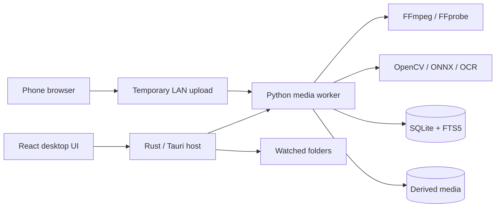

# OpenWorld Moments

> Turn fragmented console gameplay captures into searchable sessions and editable stories—locally, privately, and without modifying the game.

OpenWorld Moments is a planned open-source desktop application for organizing, understanding, and editing console gameplay captures. GTA VI is the first compatibility target, but the underlying event and profile system is intended to support other open-world games.

The application will import clips from Xbox OneDrive folders, PlayStation phone downloads, USB copies, OBS recordings, and capture-card files. It will reconstruct overlapping recordings into sessions, recognize visible gameplay events, and propose complete clips containing the setup, escalation, payoff, and reaction.

OpenWorld Moments is **not** a console mod, recorder, cheat, game-memory reader, or Rockstar product. It runs on the user's computer and processes video files the user explicitly provides.

## Project status

**Foundation lane in progress. No usable application has been released yet.**

Completed milestones:

| Milestone | What it delivered |
|---|---|
| M00 — Repository foundation | Tauri desktop shell with a planning-stage placeholder, Python media-worker package, CI for TypeScript, Rust, and Python, split licensing |
| M01 — Contracts and versioning | Versioned JSON Schema contracts (`packages/contracts/`) with generated TypeScript and Pydantic types and a drift check |
| M02 — Database and migrations | SQLite library database (WAL) with migrations, pre-upgrade backups, and typed repositories ([storage guide](./docs/architecture/storage.md)) |
| M03 — Worker lifecycle and job engine | Desktop host starts and supervises the Python worker over a loopback, token-protected API; durable cancellable jobs with live progress ([worker guide](./docs/architecture/worker.md)) |
| M04 — Media probing | FFmpeg discovery with a `doctor` capability report; a read-only `probe` job that normalizes streams, exact frame rates, rotation, and HDR metadata, with stable error codes ([media guide](./docs/architecture/media.md)) |
| M05 — Safe import pipeline | Idempotent reference and managed-copy imports of files and folders, gated by the probe; staged copies promoted atomically into content-addressed storage; provenance, missing-source detection, and verified relink ([import guide](./docs/architecture/import.md)) |
| M06 — Fingerprints and duplicate detection | Fast partial hashes that skip re-copying known files, versioned perceptual frame and audio fingerprints, review-only duplicate candidates, and a restartable backfill job ([fingerprints guide](./docs/architecture/fingerprints.md)) |
| M07 — Watched folders and Xbox onboarding | Native folder watching with stabilization, startup and periodic reconciliation, offline backoff, and cloud-placeholder handling; watched-folder settings and an Xbox/OneDrive onboarding card in the app ([watched folders](./docs/architecture/watched-folders.md), [Xbox guide](./docs/guides/xbox-onedrive.md)) |
| M08 — Proxies, thumbnails, and waveforms | Explainable proxy decisions; deterministic H.264 SDR proxies with LUT-based HDR tone mapping; filmstrip thumbnails and compact waveforms; cache keys with invalidation, atomic promotion, validated outputs, cancellation, and safe cleanup ([derived media](./docs/architecture/derived-media.md)) |
| M09 — Desktop library and jobs UI | The first usable app: import by button or drag and drop, a paged library with thumbnails, clip pages that play a proxy or the original over a range-capable media protocol, automatic playback preparation, and a background-job center with progress, cancel, retry, and readable errors ([desktop UI](./docs/architecture/desktop-ui.md)) |
| M10 — Phone QR upload (in review: real-phone smoke test on Windows pending) | "Import from phone": a temporary, separate LAN upload gateway on a chosen private address with a 256-bit, 10-minute QR link; streamed, size-limited, type-checked uploads into a fixed staging folder; managed imports of received clips ([phone upload](./docs/architecture/phone-upload.md), [guide](./docs/guides/phone-upload.md)) |
| M11 — Session grouping | Explainable capture-time estimates (filename, container, mtime, with confidence and time-zone caveats), deterministic metadata grouping into candidate sessions with per-join evidence, an idempotent recompute job, and merge/split/reorder/remove/confirm corrections that survive recomputation ([sessions](./docs/architecture/sessions.md)) |
| M12 — Visual and audio overlap | Finds repeated replay footage between adjacent clips from fingerprints (continuous frame matching, ambiguity rejection, audio refinement), applies only confident results to the session layout, and keeps user overrides above recomputation ([overlap](./docs/architecture/overlap.md)) |
| M13 — Virtual session timeline | A Sessions screen and a session player that plays a whole session as one gap-free timeline: clips switch seamlessly at boundaries without replaying repeated footage, which can be revealed; frame steps, keyboard controls, a track with thumbnails, waveforms, and overlap confidence, and reorder/split/merge/override corrections, with every moment traceable to its source clip ([session timeline](./docs/architecture/session-timeline.md)) |
| M14 — Detector SDK and profiles | Local JSON profile validation/inheritance, immutable derived-frame inputs, isolated cancellable built-in detectors, versioned caches and evidence-backed events; a synthetic temporal example and `owm` CLI ([detector runtime](./docs/architecture/detectors.md)) |
| M15 — Profile calibration UI | Settings-based frame capture and accessible normalized ROI editing; durable local overrides, crop/preprocessing and synthetic SDK previews, base comparison/reset, and media-free profile patches ([calibration](./docs/architecture/profile-calibration.md)) |
| M16 — Wanted-state detector | Calibrated analytic star/disc rows, conservative temporal changes with local crop references and explainable scores, replay traces and benchmark; synthetic validation only, game compatibility unvalidated ([wanted detector](./docs/detectors/wanted.md)) |
| M17 — Banner and subtitle detectors | Local region-only Tesseract OCR, versioned locale vocabulary, confirmed banner/subtitle intervals with line evidence and mission spoiler-risk metadata; synthetic validation, optional engine/data and explicit unavailable results ([text detectors](./docs/detectors/text.md)) |
| M18 — Audio analysis and transcription | Deterministic audio features from the playback copy's first audio stream (onsets/impacts, silence, speech-like activity), always labelled supporting evidence; optional local whisper.cpp transcription with explicitly installed models, word timings in session time, per-clip cached and cancellable jobs, a privacy notice and text-only deletion in the session screen ([audio](./docs/detectors/audio.md), [transcription](./docs/architecture/transcription.md), [guide](./docs/guides/transcription.md)) |
| M19 — Event review and evaluation | Timeline event markers, evidence/provenance inspector, immutable observations with separate audited corrections and manual events; reproducible local holdout metrics and privacy-minimized JSON/Markdown compatibility reports ([review](./docs/architecture/event-review.md), [evaluation](./docs/evaluation/README.md)) |
| M20 — Story engine | Deterministic event-to-story windows with source ranges, narrative beats, speech-aware boundaries, duration presets, decomposed scores and alternatives; audited accept/reject/regeneration, local CLI/API and synthetic coverage report ([engine](./docs/architecture/stories.md), [guide](./docs/stories/README.md)) |
| M21 — Editor project model | Versioned non-destructive EDL with source bindings, pure timeline commands and undo/redo, debounced revision-checked autosave/recovery, manual session selection and portable import/export/relink ([editor model](./docs/architecture/editor-projects.md)) |
| M22 — Focused editor UI | Projects browser and manual session-range creation; source-mapped preview, trim handles/numeric times, split/remove/reorder, undo/redo and revision-checked autosave with retained drafts and recovery; keyboard alternatives and read-only event context ([focused editor](./docs/architecture/focused-editor.md)) |
| M23 — Captions and audio controls | Transcript-backed editable captions, Unicode SRT/VTT sidecars, caption placement/style and burn-in intent, protected-region warnings, and project/cut/range gain and mute preview with waveform shading ([captions and audio](./docs/architecture/captions-and-audio.md)) |
| M24 — Render engine | Exports a saved project revision to a validated horizontal H.264/AAC MP4: argument-array FFmpeg graphs (no shell), verified originals, exact trims, crop/fit/fill, privacy blur, gain/mute, HDR tone mapping, tested hardware encoders with an explicit CPU fallback, progress/cancel, FFprobe and sampled-decode validation, atomic completion with a reproducibility manifest; an Export panel in the editor ([render engine](./docs/architecture/render.md), [presets](./presets/README.md)) |

You can import clips (by button, drag and drop, a watched folder, or from your phone over Wi-Fi), browse them in the library, and play them, with playback copies prepared automatically. Clips are grouped into play sessions that play back as one continuous timeline with repeated footage skipped; profiles can be calibrated visually and the detector runtime can infer wanted-indicator changes from a regular synthetic star/disc HUD. Local OCR can also produce confirmed banner and subtitle intervals from calibrated regions, audio analysis adds supporting loudness, silence and speech-activity evidence, and sessions can be transcribed locally with your own whisper.cpp install and model. Game compatibility remains unvalidated. Events can now be inspected, approved, rejected, corrected or added manually on the session timeline; story candidates can be generated and reviewed through the local CLI/API, and manual or existing projects can be edited visually through the Projects screen, including caption correction and simple audio gain/mute. Development is divided into self-contained milestones intended to be completed in separate agent or contributor sessions.

- [Complete product and engineering specification](./OPENWORLD_MOMENTS_BUILD_SPEC.md)
- [Milestone index and dependency graph](./MILESTONES.md)
- [Individual milestone briefs](./docs/milestones/)
- [Architecture decision records](./docs/architecture/)

## Local development

### Prerequisites

| Tool | Version | Notes |
|---|---|---|
| Node.js | 22.x (`.node-version`) | |
| pnpm | 12.16.1 (`packageManager` in `package.json`) | `corepack enable` or install pnpm directly |
| Rust | 1.97.1 (`rust-toolchain.toml`) | Installed automatically by `rustup` on first `cargo` call |
| Python | 3.12 (`.python-version`) | `uv` can install it: `uv python install 3.12` |
| uv | 0.13 or newer | Python dependency management |
| FFmpeg | 6.0 or newer, with `libx264` | `ffprobe` probes media; `ffmpeg` generates test fixtures. Check with `pnpm media:doctor` ([details](./docs/architecture/media.md#ffmpeg-requirement)) |
| Tesseract | 5+ (optional) | Required for M17 OCR; install selected language data explicitly. CI/local OCR validation uses `OWM_REQUIRE_OCR=1`; see [setup and limits](./docs/detectors/text.md). |
| Tauri system dependencies | — | See [Tauri prerequisites](https://tauri.app/start/prerequisites/): WebView2 + MSVC build tools on Windows, Xcode on macOS, WebKitGTK on Linux |

### Setup

```bash
pnpm install
uv sync --all-packages
```

### Commands

Run from the repository root:

| Command | What it does |
|---|---|
| `pnpm dev` | Launch the desktop app with hot reload |
| `pnpm format` | Format TypeScript (Prettier), Rust (rustfmt), and Python (Ruff) |
| `pnpm format:check` | Check formatting without writing |
| `pnpm lint` | ESLint, Clippy, Ruff, and REUSE license compliance |
| `pnpm typecheck` | `tsc` and mypy (Rust is type-checked by Clippy and tests) |
| `pnpm test` | Vitest, `cargo test`, and pytest smoke tests |
| `pnpm build` | Production desktop build without installers |
| `pnpm build:bundle` | Production build plus platform installers |
| `pnpm contracts:generate` | Regenerate TypeScript and Python types from `packages/contracts/schemas/` |
| `pnpm contracts:check` | Regenerate and fail if the committed generated files differ |
| `pnpm media:doctor` | Report FFprobe/FFmpeg versions and codecs; exit 1 if media probing cannot work |
| `pnpm media:fixtures <dir>` | Generate the synthetic test clips (relative to `services/media-worker/`; never commit them) |
| `uv run --directory services/media-worker owm profiles validate ../../profiles/generic-open-world/profile.json` | Validate a local JSON profile (manifest path is relative to the worker directory) |
| `uv run --directory services/media-worker owm demo` | Generate temporary synthetic media and run the example detector end to end |
| `uv run --directory services/media-worker owm wanted benchmark` | Measure the wanted estimator and temporal filter on one hour of synthetic ROI samples |
| `uv run --directory services/media-worker owm text doctor` | Check the optional local Tesseract engine and installed English data |
| `uv run --directory services/media-worker owm text benchmark` | Measure uncached banner and subtitle OCR on generated development fixtures |
| `pnpm check` | `format:check`, `lint`, `typecheck`, `test`, and `contracts:check` together |

Each command also has per-toolchain variants, such as `pnpm lint:rs` or `pnpm test:py`.

Commits must be signed off (`git commit -s`) under the [Developer Certificate of Origin](https://developercertificate.org/).

## Target desktop platforms

The release roadmap now covers both Windows and macOS:

- Windows 11 x64 is qualified first in M32.
- macOS 14+ on Apple Silicon is supported through a native `arm64` DMG.
- macOS 14+ on supported Intel Macs is supported through a native `x86_64` DMG.
- M39 is the final dual-platform qualification gate.

The two Mac packages are separate so neither architecture requires Rosetta and every bundled worker/media dependency remains native. Linux remains a later target. See the [macOS delivery plan](./docs/platforms/macos-delivery-plan.md) for packaging, permissions, testing, signing, and notarization details.

## Why this exists

Console capture systems are useful but leave creators with a weak workflow:

- Captures have generic filenames.
- Replay-buffer clips often contain overlapping footage.
- One event may be split across several files.
- Generic AI clippers frequently select a reaction without its cause.
- Vertical center-crops remove subtitles, the minimap, wanted indicators, or the actual action.
- Cloud tools require long uploads and may impose accounts, usage limits, or subscriptions.
- Professional editors are powerful but require extensive manual review.

OpenWorld Moments addresses the layer between console capture and final editing.

```text
Console captures
    -> safe local import
    -> deduplication and session reconstruction
    -> gameplay event detection
    -> searchable timeline
    -> complete story suggestions
    -> editable horizontal and vertical exports
```

## Planned capabilities

### Console-friendly ingestion

- Watch an Xbox/OneDrive capture folder.
- Import files and folders manually.
- Transfer PlayStation App downloads from a phone through a temporary local QR upload page.
- Reference files in place or copy them into a managed library.
- Preserve all original media without modification.

### Session reconstruction

- Group adjacent captures from the same play session.
- Identify exact duplicates.
- Detect replay-buffer overlap through visual and audio alignment.
- Hide duplicated time in a virtual session while retaining every original file.
- Let users merge, split, reorder, and correct sessions.

### Gameplay understanding

The first game profile is planned to detect a conservative set of visible events:

- Wanted-level changes.
- Death and failure states.
- Arrest/busted states.
- Mission start, progress, success, and failure text.
- Dialogue and subtitle regions.
- Audio impacts, reactions, and excitement peaks as supporting evidence.

Every event will include its timestamp, confidence, detector version, profile version, and supporting evidence. The system should say “unknown” rather than inventing an event.

### Story-aware clipping

Rather than selecting only a loud moment, OpenWorld Moments will look for:

- Setup.
- Incident.
- Escalation.
- Payoff.
- Reaction.

Suggestions remain drafts. Users can adjust every boundary and create a clip manually when automation fails.

### Focused editing

- Trim, split, reorder, and remove segments.
- Correct captions.
- Mute ranges or adjust simple gain.
- Preview multiple aspect ratios from one project.
- Preserve important HUD and subtitle regions in vertical video.
- Export normal MP4 files, captions, event metadata, and open timeline formats.

### Local-first privacy

- No account required.
- No mandatory cloud inference.
- No analytics SDK in the initial application.
- No automatic footage upload.
- Explicit, temporary LAN transfer for phone imports.
- Redacted support bundles that exclude footage and transcripts by default.

## What the project will not do

- Install or run on PlayStation or Xbox.
- Inject into GTA VI or GTA Online.
- Read game memory, packets, save files, or proprietary archives.
- Generate controller input or automate gameplay.
- Bypass anti-cheat or platform protections.
- Redistribute official game assets or leaked footage.
- Promise that a suggested clip will become viral.
- Replace a full nonlinear editor such as DaVinci Resolve or Premiere Pro.

## Intended architecture

The current technical direction is:



Planned stack:

- Tauri 2, React, TypeScript, and Vite for the desktop application.
- Rust for application lifecycle, watched folders, secure tokens, and worker management.
- Python 3.12, FastAPI, OpenCV, ONNX Runtime, NumPy, and SciPy for media analysis.
- FFmpeg and FFprobe for probing, proxying, and rendering.
- SQLite in WAL mode with FTS5 for canonical storage and search.
- Optional whisper.cpp transcription downloaded only with user approval.

Architecture decisions may change through reviewed ADRs, but milestone acceptance criteria should remain stable unless the specification is amended.

## Milestone-driven development

Implementation is divided into 40 milestones sized for one focused contributor or agent session. Each milestone has:

- Explicit prerequisites.
- A narrow objective.
- In-scope and out-of-scope work.
- Bounded integration surfaces.
- Required implementation steps.
- Acceptance criteria.
- Required tests and validation commands.
- Documentation and handoff requirements.

Milestones should be completed in their own branches and submitted independently.

```text
milestone/M00-repository-foundation
milestone/M01-contracts-and-versioning
milestone/M02-database-and-migrations
...
```

The full sequence is maintained in [MILESTONES.md](./MILESTONES.md). A contributor should not begin a milestone until every dependency is merged, unless the milestone index explicitly marks the work as parallel-safe.

### Assigning one milestone to an agent

This repository includes [AGENTS.md](./AGENTS.md), so a fresh coding session receives the same completion and safety rules. An assignment can be as small as:

```text
Implement MXX from docs/milestones/MXX-name.md.
Follow AGENTS.md, verify all dependencies are merged, satisfy every acceptance
criterion, run the required validation, and finish with the milestone handoff.
Do not begin another milestone.
```

Give each person or agent a fresh branch from the latest merged dependency commit. Push and review that milestone before starting dependent work; do not pass uncommitted state between sessions.

## Release lanes

### Foundation lane

Repository tooling, contracts, persistence, worker lifecycle, and job orchestration.

### Media lane

Probing, import, hashing, watched folders, proxies, phone transfer, and library UI.

### Intelligence lane

Session reconstruction, overlap alignment, detector profiles, game-event detection, transcription, evaluation, and story generation.

### Creation lane

Timeline editing, captions, rendering, HUD-aware vertical layouts, search, safety review, and open exports.

### Release lane

Windows packaging and alpha qualification, macOS native packaging, security hardening, signing/notarization, accessibility review, documentation, and final dual-platform qualification.

## Contributing

The repository is designed for milestone-based contributions. Before starting:

1. Read this README.
2. Read [OPENWORLD_MOMENTS_BUILD_SPEC.md](./OPENWORLD_MOMENTS_BUILD_SPEC.md).
3. Read [MILESTONES.md](./MILESTONES.md).
4. Read the individual milestone brief.
5. Confirm all prerequisite milestones are merged.
6. Create a branch named after the milestone.

Do not combine unrelated cleanup or another milestone's deliverables into the same branch. If a prerequisite defect blocks the work, document it and make the smallest necessary correction with an explicit note in the handoff.

Every completed milestone must include:

- Implementation.
- Automated tests required by the milestone.
- Updated documentation.
- Validation command output or a concise validation summary.
- A handoff note listing files changed, decisions made, known limitations, and follow-up work.

See [CONTRIBUTING.md](./CONTRIBUTING.md) for the full workflow.

## Detector and footage contribution policy

Detector contributions are welcome, but gameplay media requires careful handling:

- Do not submit leaked or pre-release footage.
- Do not commit official trailers, music, fonts, textures, logos, maps, or extracted assets.
- Prefer synthetic fixtures.
- User-owned footage requires an explicit right to contribute it under the repository's fixture policy.
- Local evaluation manifests may reference footage outside the repository.
- Metrics, hashes, annotations, and minimal lawful crops are preferred over full gameplay files.

Every detector contribution must document supported resolution, locale, HUD scale, known false positives, model/data licenses, and reproducible evaluation results.

## Security

Media files are untrusted input. Security-sensitive areas include FFmpeg invocation, archive handling, phone upload, local API authentication, filename sanitization, model downloads, and future plugins.

Do not report vulnerabilities through a public issue. Follow [SECURITY.md](./SECURITY.md).

## Legal and affiliation notice

OpenWorld Moments is an unofficial community project. Grand Theft Auto, GTA, GTA VI, Rockstar Games, and related marks and content belong to their respective owners. Compatibility references are descriptive only.

The repository will not include Rockstar game assets or leaked footage. Users are responsible for ensuring they have the right to process and publish their footage, including any music, voice chat, usernames, or story content contained in it.

The application is designed to operate only on media selected by the user. It does not modify a game or interact with online services.

## License

OpenWorld Moments uses a split license. See [LICENSE.md](./LICENSE.md) for the full map and [LICENSES/](./LICENSES/) for the texts:

- AGPL-3.0-or-later for the desktop application and media worker.
- Apache-2.0 for schemas, profiles, and integration SDKs (`packages/contracts/`, `profiles/`).
- CC BY 4.0 for documentation.

[REUSE.toml](./REUSE.toml) is the machine-readable source of truth, checked in CI.

## Research and prior art

The product specification includes links to console capture documentation, existing open-source clippers, video-search tools, OCR/capture-card projects, and GTA companion products. See [Research references](./OPENWORLD_MOMENTS_BUILD_SPEC.md#25-research-references).

## Current next step

M24 renders saved projects to validated horizontal MP4s inside the library. Several
milestones now have their prerequisites (see [MILESTONES.md](./MILESTONES.md)):

- [M25 — HUD-aware vertical layouts](./docs/milestones/M25-hud-aware-vertical-layouts.md): safe crop, fit and layout keyframes on top of the M24 renderer.
- [M27 — Open exports and manifests](./docs/milestones/M27-open-exports-and-manifests.md): JSONL, captions, OTIO and reproducibility exports, including saving renders outside the library.
- M26 search/collections, M28 privacy review and M29 Windows packaging are also ready.

Text overlays and burned-in captions are recorded but not drawn yet (an explicit
omission hook); see the [M24 handoff](./docs/milestones/M24-handoff.md) and
[render engine](./docs/architecture/render.md).

M10 still needs its real-phone smoke test on a Windows private network. Detector
quality remains synthetic/local; GTA profiles are unvalidated and M18 real
whisper.cpp recognition is unmeasured. See the [M20 handoff](./docs/milestones/M20-handoff.md),
[story algorithm](./docs/architecture/stories.md) and [synthetic coverage report](./docs/stories/sample/report.md).
