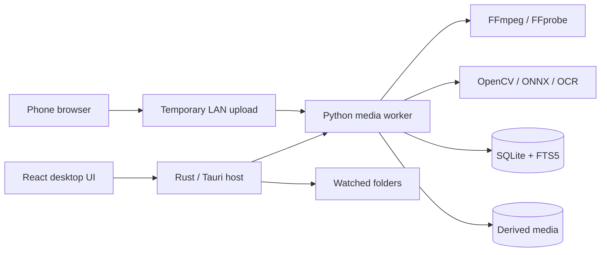

# OpenWorld Moments

> Turn fragmented console gameplay captures into searchable sessions and editable stories—locally, privately, and without modifying the game.

OpenWorld Moments is a planned open-source desktop application for organizing, understanding, and editing console gameplay captures. GTA VI is the first compatibility target, but the underlying event and profile system is intended to support other open-world games.

The application will import clips from Xbox OneDrive folders, PlayStation phone downloads, USB copies, OBS recordings, and capture-card files. It will reconstruct overlapping recordings into sessions, recognize visible gameplay events, and propose complete clips containing the setup, escalation, payoff, and reaction.

OpenWorld Moments is **not** a console mod, recorder, cheat, game-memory reader, or Rockstar product. It runs on the user's computer and processes video files the user explicitly provides.

## Project status

**Specification and milestone planning. No usable application has been released yet.**

The repository currently contains the product specification and the implementation plan. Development is divided into self-contained milestones intended to be completed in separate agent or contributor sessions.

- [Complete product and engineering specification](./OPENWORLD_MOMENTS_BUILD_SPEC.md)
- [Milestone index and dependency graph](./MILESTONES.md)
- [Individual milestone briefs](./docs/milestones/)

The first code milestone is [M00 — Repository foundation](./docs/milestones/M00-repository-foundation.md).

## Why this exists

Console capture systems are useful but leave creators with a weak workflow:

- Captures have generic filenames.
- Replay-buffer clips often contain overlapping footage.
- One event may be split across several files.
- Generic AI clippers frequently select a reaction without its cause.
- Vertical center-crops remove subtitles, the minimap, wanted indicators, or the actual action.
- Cloud tools require long uploads and may impose accounts, usage limits, or subscriptions.
- Professional editors are powerful but require extensive manual review.

OpenWorld Moments addresses the layer between console capture and final editing.

```text
Console captures
    -> safe local import
    -> deduplication and session reconstruction
    -> gameplay event detection
    -> searchable timeline
    -> complete story suggestions
    -> editable horizontal and vertical exports
```

## Planned capabilities

### Console-friendly ingestion

- Watch an Xbox/OneDrive capture folder.
- Import files and folders manually.
- Transfer PlayStation App downloads from a phone through a temporary local QR upload page.
- Reference files in place or copy them into a managed library.
- Preserve all original media without modification.

### Session reconstruction

- Group adjacent captures from the same play session.
- Identify exact duplicates.
- Detect replay-buffer overlap through visual and audio alignment.
- Hide duplicated time in a virtual session while retaining every original file.
- Let users merge, split, reorder, and correct sessions.

### Gameplay understanding

The first game profile is planned to detect a conservative set of visible events:

- Wanted-level changes.
- Death and failure states.
- Arrest/busted states.
- Mission start, progress, success, and failure text.
- Dialogue and subtitle regions.
- Audio impacts, reactions, and excitement peaks as supporting evidence.

Every event will include its timestamp, confidence, detector version, profile version, and supporting evidence. The system should say “unknown” rather than inventing an event.

### Story-aware clipping

Rather than selecting only a loud moment, OpenWorld Moments will look for:

- Setup.
- Incident.
- Escalation.
- Payoff.
- Reaction.

Suggestions remain drafts. Users can adjust every boundary and create a clip manually when automation fails.

### Focused editing

- Trim, split, reorder, and remove segments.
- Correct captions.
- Mute ranges or adjust simple gain.
- Preview multiple aspect ratios from one project.
- Preserve important HUD and subtitle regions in vertical video.
- Export normal MP4 files, captions, event metadata, and open timeline formats.

### Local-first privacy

- No account required.
- No mandatory cloud inference.
- No analytics SDK in the initial application.
- No automatic footage upload.
- Explicit, temporary LAN transfer for phone imports.
- Redacted support bundles that exclude footage and transcripts by default.

## What the project will not do

- Install or run on PlayStation or Xbox.
- Inject into GTA VI or GTA Online.
- Read game memory, packets, save files, or proprietary archives.
- Generate controller input or automate gameplay.
- Bypass anti-cheat or platform protections.
- Redistribute official game assets or leaked footage.
- Promise that a suggested clip will become viral.
- Replace a full nonlinear editor such as DaVinci Resolve or Premiere Pro.

## Intended architecture

The current technical direction is:



Planned stack:

- Tauri 2, React, TypeScript, and Vite for the desktop application.
- Rust for application lifecycle, watched folders, secure tokens, and worker management.
- Python 3.12, FastAPI, OpenCV, ONNX Runtime, NumPy, and SciPy for media analysis.
- FFmpeg and FFprobe for probing, proxying, and rendering.
- SQLite in WAL mode with FTS5 for canonical storage and search.
- Optional whisper.cpp transcription downloaded only with user approval.

Architecture decisions may change through reviewed ADRs, but milestone acceptance criteria should remain stable unless the specification is amended.

## Milestone-driven development

Implementation is divided into milestones sized for one focused contributor or agent session. Each milestone has:

- Explicit prerequisites.
- A narrow objective.
- In-scope and out-of-scope work.
- Bounded integration surfaces.
- Required implementation steps.
- Acceptance criteria.
- Required tests and validation commands.
- Documentation and handoff requirements.

Milestones should be completed in their own branches and submitted independently.

```text
milestone/M00-repository-foundation
milestone/M01-contracts-and-versioning
milestone/M02-database-and-migrations
...
```

The full sequence is maintained in [MILESTONES.md](./MILESTONES.md). A contributor should not begin a milestone until every dependency is merged, unless the milestone index explicitly marks the work as parallel-safe.

### Assigning one milestone to an agent

This repository includes [AGENTS.md](./AGENTS.md), so a fresh coding session receives the same completion and safety rules. An assignment can be as small as:

```text
Implement MXX from docs/milestones/MXX-name.md.
Follow AGENTS.md, verify all dependencies are merged, satisfy every acceptance
criterion, run the required validation, and finish with the milestone handoff.
Do not begin another milestone.
```

Give each person or agent a fresh branch from the latest merged dependency commit. Push and review that milestone before starting dependent work; do not pass uncommitted state between sessions.

## Release lanes

### Foundation lane

Repository tooling, contracts, persistence, worker lifecycle, and job orchestration.

### Media lane

Probing, import, hashing, watched folders, proxies, phone transfer, and library UI.

### Intelligence lane

Session reconstruction, overlap alignment, detector profiles, game-event detection, transcription, evaluation, and story generation.

### Creation lane

Timeline editing, captions, rendering, HUD-aware vertical layouts, search, safety review, and open exports.

### Release lane

Packaging, security hardening, accessibility review, documentation, and public-alpha qualification.

## Contributing

The repository is designed for milestone-based contributions. Before starting:

1. Read this README.
2. Read [OPENWORLD_MOMENTS_BUILD_SPEC.md](./OPENWORLD_MOMENTS_BUILD_SPEC.md).
3. Read [MILESTONES.md](./MILESTONES.md).
4. Read the individual milestone brief.
5. Confirm all prerequisite milestones are merged.
6. Create a branch named after the milestone.

Do not combine unrelated cleanup or another milestone's deliverables into the same branch. If a prerequisite defect blocks the work, document it and make the smallest necessary correction with an explicit note in the handoff.

Every completed milestone must include:

- Implementation.
- Automated tests required by the milestone.
- Updated documentation.
- Validation command output or a concise validation summary.
- A handoff note listing files changed, decisions made, known limitations, and follow-up work.

See [CONTRIBUTING.md](./CONTRIBUTING.md) for the full workflow.

## Detector and footage contribution policy

Detector contributions are welcome, but gameplay media requires careful handling:

- Do not submit leaked or pre-release footage.
- Do not commit official trailers, music, fonts, textures, logos, maps, or extracted assets.
- Prefer synthetic fixtures.
- User-owned footage requires an explicit right to contribute it under the repository's fixture policy.
- Local evaluation manifests may reference footage outside the repository.
- Metrics, hashes, annotations, and minimal lawful crops are preferred over full gameplay files.

Every detector contribution must document supported resolution, locale, HUD scale, known false positives, model/data licenses, and reproducible evaluation results.

## Security

Media files are untrusted input. Security-sensitive areas include FFmpeg invocation, archive handling, phone upload, local API authentication, filename sanitization, model downloads, and future plugins.

Do not report vulnerabilities through a public issue. Follow [SECURITY.md](./SECURITY.md).

## Legal and affiliation notice

OpenWorld Moments is an unofficial community project. Grand Theft Auto, GTA, GTA VI, Rockstar Games, and related marks and content belong to their respective owners. Compatibility references are descriptive only.

The repository will not include Rockstar game assets or leaked footage. Users are responsible for ensuring they have the right to process and publish their footage, including any music, voice chat, usernames, or story content contained in it.

The application is designed to operate only on media selected by the user. It does not modify a game or interact with online services.

## License

Licensing is finalized before the first code release. The current product specification recommends:

- AGPL-3.0-or-later for the desktop application and media worker.
- Apache-2.0 for schemas and integration SDKs.
- CC BY 4.0 for project documentation.

Until the corresponding license files are committed, the planning documents remain copyright their contributors with no implied license beyond GitHub's terms. Milestone M00 is responsible for installing the approved license set before accepting implementation contributions.

## Research and prior art

The product specification includes links to console capture documentation, existing open-source clippers, video-search tools, OCR/capture-card projects, and GTA companion products. See [Research references](./OPENWORLD_MOMENTS_BUILD_SPEC.md#25-research-references).

## Current next step

Complete [M00 — Repository foundation](./docs/milestones/M00-repository-foundation.md), then proceed through the dependency graph in [MILESTONES.md](./MILESTONES.md).

