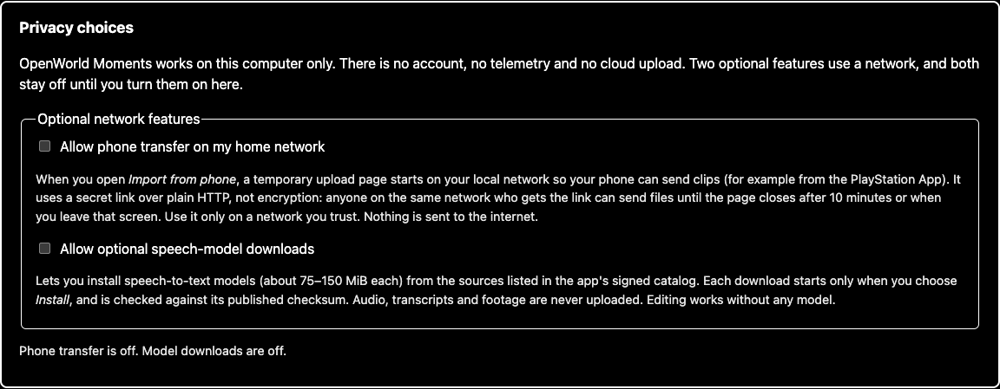

# Accessibility

> **Applies to:** OpenWorld Moments 0.1.0 alpha for Windows 11 (x64).
> **Last checked:** 2026-11-11 (M31).

OpenWorld Moments is meant to be usable with a keyboard alone, with a screen reader, at
large text sizes and in high contrast. This page lists what is supported, how it was
tested, and the known gaps.

## Display settings

**Settings → Display and motion** (also offered in first-run setup):

- **Theme:** *Match my system*, *Light*, *Dark* or *High contrast*. High contrast uses
  white text on black, yellow links and buttons, thicker outlines and underlined links.
- **Text size:** 100% to 200%. Layout and spacing scale with the text.
- **Reduce motion:** turns off animated transitions. The app also follows the Windows
  *Animation effects* setting.

Windows **contrast themes** are respected: system colors are used and every control
keeps an outline. Status is always written in words (*Passed*, *Failed*, *Ready*), never
shown by color alone.

## Keyboard shortcuts

Everywhere:

| Keys | Action |
|---|---|
| Tab, Shift+Tab | Move between controls |
| Enter, Space | Activate a button, link or checkbox |
| First Tab on a page | **Skip to content** |
| / or Ctrl+K | Open Search (or focus the search box) |
| Esc | Close the Import dialog; clear the search box |

In Search, **Down** moves from the box into the results and **Up**/**Down** move between
them.

Session player:

| Keys | Action |
|---|---|
| Space or K | Play or pause |
| Left, Right | Back or forward 5 seconds |
| , and . | Previous or next frame |
| [ and ] | Previous or next clip boundary |
| Home, End | Start or end |
| R | Show or hide repeated footage |
| M | Mute |

Story editor (the full list is under **Editor keyboard shortcuts** in the editor):

| Keys | Action |
|---|---|
| Space or K | Play or pause |
| , and . | Previous or next frame |
| [ and ] | Previous or next cut boundary |
| Home, End | Start or end |
| S | Split the selected cut at the playhead |
| Delete | Remove the selected cut |
| Ctrl+Z, Ctrl+Shift+Z | Undo, redo |
| Ctrl+S | Save now |

Cuts can be reordered with **Move earlier** and **Move later**, and trimmed with the in
and out sliders (arrow keys) or by typing milliseconds.

## Screen readers

- Every control has a name, every screen has one main heading, and landmarks mark the
  navigation and the main content.
- Progress, completion and errors are announced. Background jobs announce when they
  finish (*Render video finished.*) and, more urgently, when they fail, wherever you
  are in the app.
- First-run setup moves focus to each new step's heading.
- Dialogs keep focus inside until closed and return it to the control that opened them.

## Support matrix

What was checked for this version, and how. "Automated" checks run on every change.

| Area | Method | Result |
|---|---|---|
| Accessible names, roles, landmarks, labels, ARIA | axe-core on every primary screen and every setup step (automated) | No violations |
| Color contrast | WCAG 2.2 ratios for every theme's text, link, button, warning and focus colors (automated) | AA in Light, Dark and system themes; AAA in High contrast |
| Keyboard-only: import, review, edit, render, locate output | Component tests with keyboard events (automated) | Pass |
| Keyboard: Tab order and visible focus | Browser smoke in Chrome (`scripts/docs/a11y-smoke.py`) on Library, Settings, Phone and Search | Pass; focus visible at every stop (see exceptions) |
| Keyboard: setup and Import dialog | Browser smoke | Pass: setup completes with Enter; Tab stays in the dialog; Esc returns focus |
| 200% text size | Browser smoke, 1280 px window | No horizontal scrolling |
| 200% zoom | Browser smoke, 640 CSS px viewport at 2× scale | No horizontal scrolling |
| Narrow window | Browser smoke, 400 px | No horizontal scrolling |
| Windows contrast themes | Browser smoke with forced colors | Focus and control outlines visible |
| Reduced motion | Browser smoke, from Settings and from the system setting | Transitions off |
| Status announcements | Component tests of the live regions (automated) | Pass |
| Windows Narrator, NVDA | Manual | **Not yet tested** (Windows qualification, M32) |
| WebView2 on Windows 11 | Manual keyboard pass in the packaged app | **Not yet tested** (M32) |

### Known exceptions

- **Date fields** (Search filters) use the browser's built-in calendar button, which
  draws its own focus ring rather than the app's.
- **Calibration regions** can be moved and resized with the keyboard, but drawing a new
  one is easiest with a mouse.
- **Timeline scrubbing** by clicking is mouse-only; use the player keys or the
  millisecond fields instead.
- **Tutorial videos:** there are none yet. Any added later will be captioned.

## Reporting a problem

If something is hard or impossible to use with your setup, tell us which screen, what
you tried and which assistive technology you use. A
[diagnostics report](./diagnostics.md) helps and contains nothing personal.
