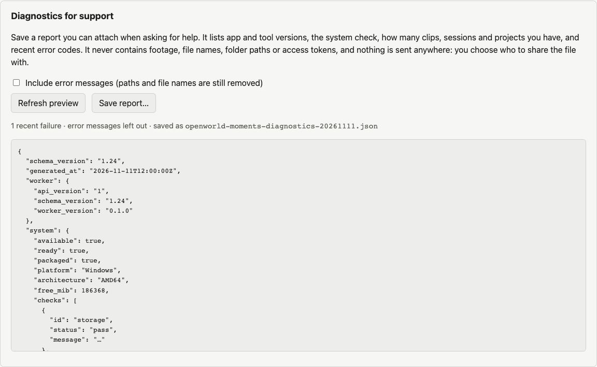

# Diagnostics for support

> **Applies to:** OpenWorld Moments 0.1.0 alpha for Windows 11 (x64).
> **Last checked:** 2026-11-11 (M31).

A diagnostics report helps someone else understand a problem without seeing your
footage. You see the exact text before saving it, and nothing is sent anywhere: you
decide who gets the file.

## Save a report

1. Open **Settings → Diagnostics for support**.
2. Leave **Include error messages** unticked unless you are asked for them.
3. Choose **Preview report** and read it.
4. Choose **Save report…** and pick where to save it. Existing files are never
   replaced.
5. Attach the file to your message or private report. For a security problem, follow
   [SECURITY.md](../../SECURITY.md) instead of posting publicly.

The saved file is generated again when you save, so only its timestamp can differ from
the preview.

## What it contains

- App, worker and contract versions; operating system and processor type.
- The system check results and bundled tool versions.
- **Counts** of clips, sessions, projects, renders, watched folders, collections, event
  observations and transcript segments, plus the database version.
- Optional speech models: name, version, and whether each is installed.
- Background jobs: how many of each kind ended in each state, and the error **codes** of
  the last 20 failures with their dates.

## What it never contains

- Footage, thumbnails, audio or transcripts.
- File names, clip titles, project names or folder paths.
- Access tokens or other secrets.

These rules are enforced, not just promised. The report has a fixed format
(`diagnostics-report` contract 1.24) that has no place for names or paths and declares
its own privacy settings. Every message also passes through a redactor that removes
paths, file names and tokens, and tests check it with realistic personal data.

## Error messages (optional)

**Include error messages** adds the text of each recent failure, for example *Could not
read [path] [file]: moov atom missing*. Paths and file names are still replaced with
`[path]` and `[file]`, but the remaining words come from the error, so read the preview
before sharing.
