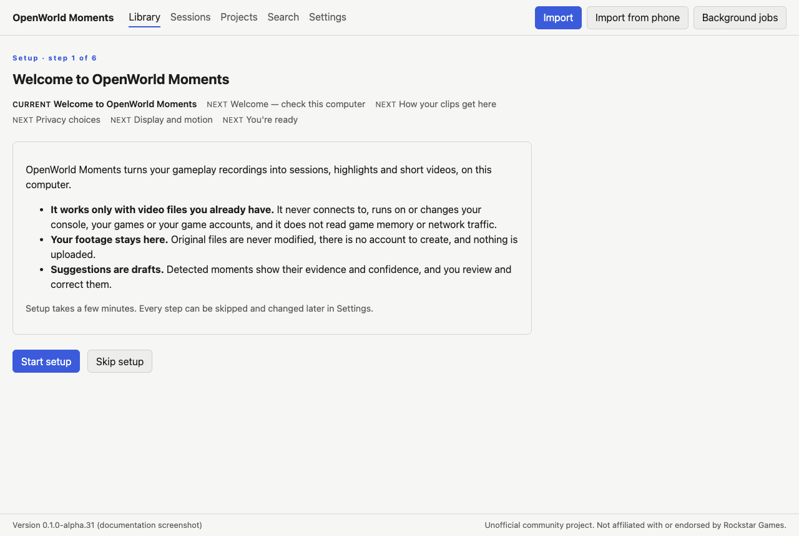
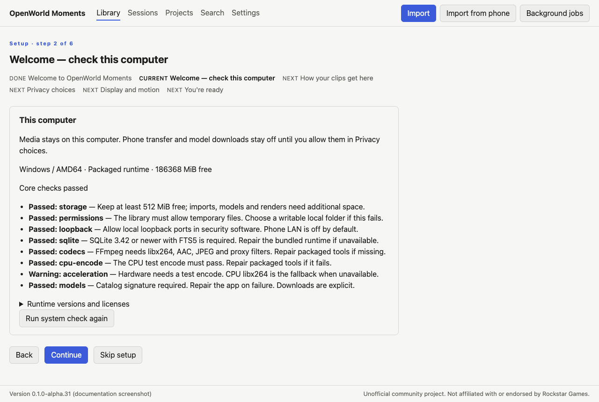
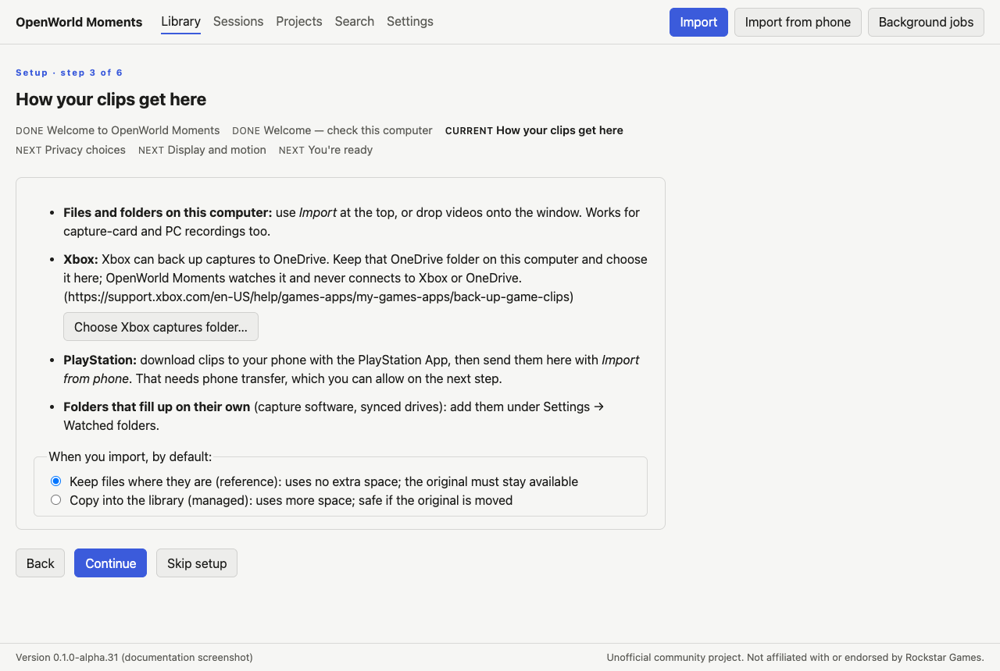
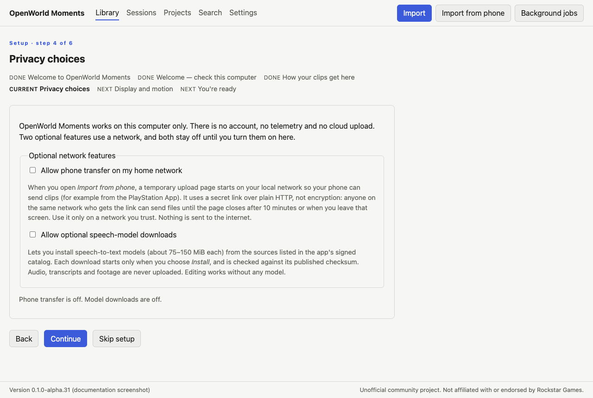
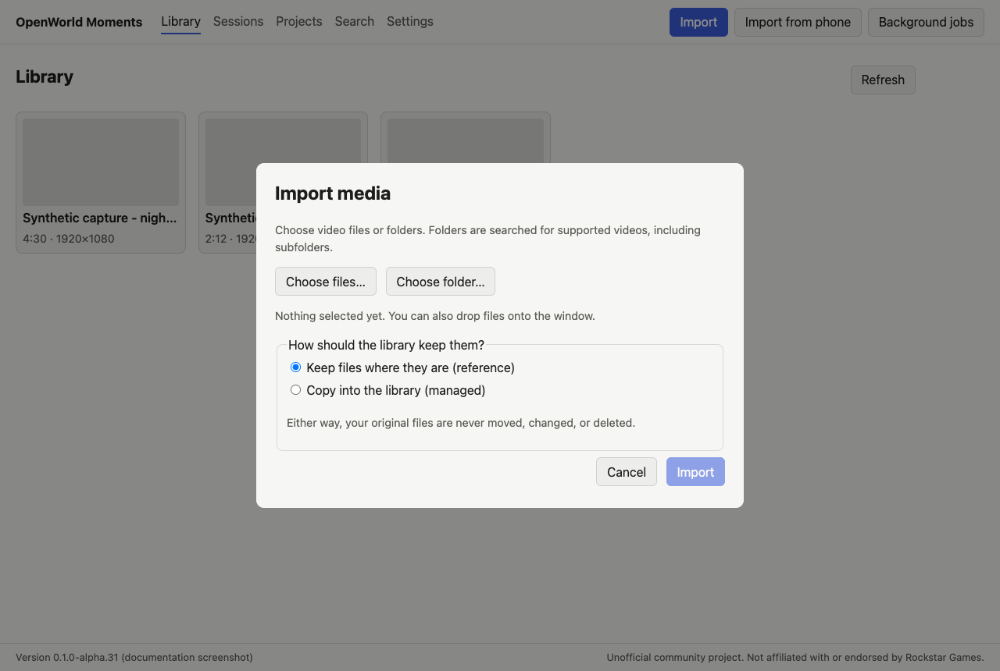
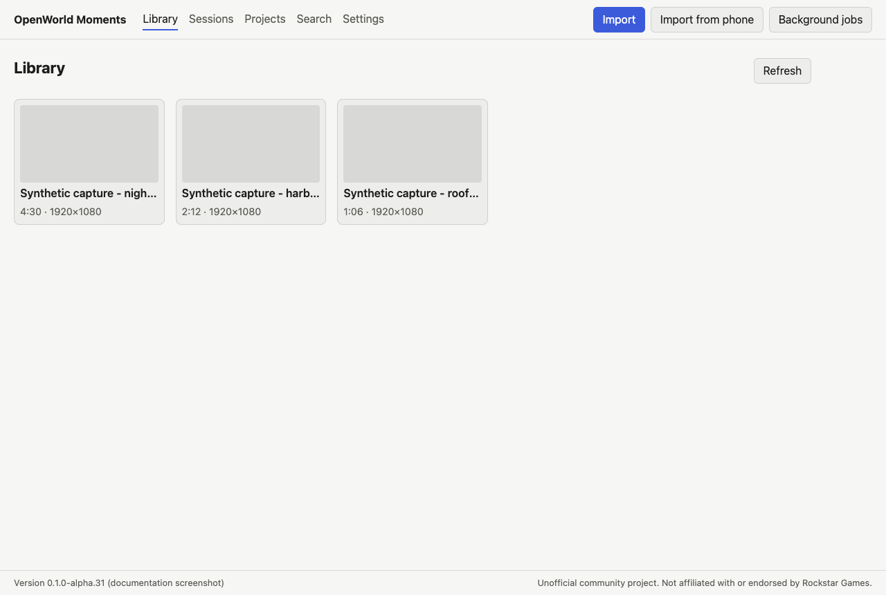

# Getting started

> **Applies to:** OpenWorld Moments 0.1.0 alpha for Windows 11 (x64).
> **Last checked:** 2026-11-11 (M31).

This guide takes you from installing the app to a finished video, in about ten minutes.
Everything happens on your computer: there is no account and nothing is uploaded.

## 1. Install

1. Download the installer and the `checksums.txt` file from the same release.
   [Verifying a release](../security/release-verification.md) shows how to check the
   download first.
2. Run `OpenWorld-Moments_<version>_Windows_x64-setup.exe`. It installs for your user
   only and does not need administrator rights.
3. The alpha installer is not signed yet, so Windows SmartScreen may say *Windows
   protected your PC*. If the checksum matched, choose **More info**, then **Run
   anyway**. Do not turn off security software.

The app keeps its library (the database, imports you copy, renders and downloaded
models) in `%APPDATA%\org.openworldmoments.desktop\library`. **Settings → Help and setup
→ Show library folder** opens it.

## 2. First-run setup

The first time the app opens, a short setup explains what it does and asks only what is
needed now. Every step can be skipped with **Skip setup**, and **Settings → Help and
setup → Run setup again** brings it back.

1. **Welcome.** OpenWorld Moments only works with video files you already have. It
   never connects to, runs on or changes your console, your games or your accounts.
2. **Check this computer.** The app checks free space, its bundled tools and local
   permissions. *Core checks passed* means you are ready. A failed check says how to
   fix it; see [Troubleshooting](./troubleshooting.md).

   
3. **How your clips get here.** Choose whether imports **keep files where they are
   (reference)** or **copy into the library (managed)**. You can also pick your Xbox
   OneDrive folder here.

   
4. **Privacy choices.** Phone transfer and optional model downloads are off. Turn one
   on only if you want it; each choice explains what it does first.
5. **Display and motion.** Theme, text size and reduced motion. See
   [Accessibility](./accessibility.md).
6. **You're ready.** Import a first clip, or go to the library.

## 3. Import

Choose **Import** at the top, then **Choose files…** or **Choose folder…**. Folders are
searched for videos, including subfolders. You can also drop files onto the window.

The import runs in the background; **Background jobs** shows its progress, and you can
keep working. Your original files are never moved, changed or deleted.

Other ways in: [Xbox through OneDrive](./xbox-onedrive.md),
[PlayStation and phone clips](./phone-upload.md), [watched folders](./watched-folders.md)
and [capture cards](./capture-card.md).

## 4. Review

- **Library** lists every clip, newest first. Open one to play it.
- **Sessions** groups clips recorded together and removes footage repeated across
  clips, so a session plays as one continuous timeline.
- In a session, **Event review** shows detected moments with their evidence and
  confidence. Confirm, correct or reject each one; nothing is final until you say so.

## 5. Edit

In a session, **Make a story from this session → Choose range to edit** lets you set an
in and out point, then **Create and edit** opens the editor. Its **Primary track** holds
the cuts. Trim them with the in and out handles, split at the playhead, reorder with
**Move earlier** and **Move later**, and switch the aspect ratio between 16:9 and 9:16.
Edits save automatically, and **Ctrl+Z** undoes. Projects are listed under **Projects**.

## 6. Render and find the video

1. In the editor's **Export** section, choose a preset and encoder, then **Render**. It
   renders the last saved revision; your originals are only read.
2. When the render reads **Ready**, choose **Show in folder**. File Explorer opens with
   the video selected.

Rendered videos are saved in the library's `renders` folder. **Save manifest…** saves a
file describing exactly what went into the render.

## Using only the keyboard

Every step above works without a mouse:

- **Tab** and **Shift+Tab** move between controls; **Enter** or **Space** activates
  them. The first Tab press offers **Skip to content**.
- **/** or **Ctrl+K** opens Search from anywhere.
- In the Import dialog, Tab stays inside the dialog and **Esc** closes it.
- The file pickers are the standard Windows dialogs.
- Players and the editor have their own shortcuts; see
  [Accessibility](./accessibility.md#keyboard-shortcuts).
